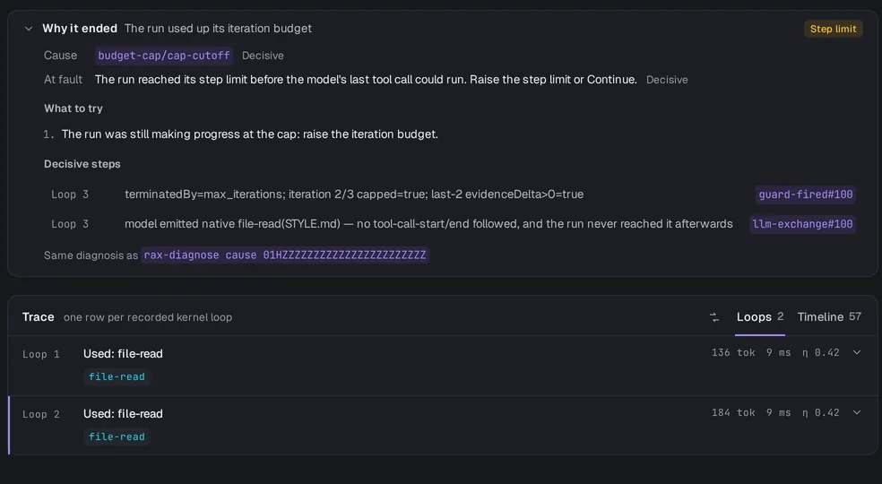

<div align="center">


# Reactive Agents

**Agents you can control, audit and improve.**

An open-source TypeScript agent harness for controllable execution, end-to-end observability, and reliable runs on local models and frontier APIs.

[](https://github.com/tylerjrbuell/reactive-agents-ts/actions/workflows/ci.yml)
[](https://www.npmjs.com/package/reactive-agents)
[](LICENSE)
[](https://www.typescriptlang.org/)
[](https://effect.website)
[](https://bun.sh)
[](https://github.com/tylerjrbuell/reactive-agents-ts/pulls)
[](https://codespaces.new/tylerjrbuell/reactive-agents-ts?quickstart=1)

[Documentation](https://docs.reactiveagents.dev/) · [Quick Start](#quick-start) · [How it compares](#how-it-compares) · [Cortex](#cortex-studio) · [Discord](https://discord.gg/Mp99vQam3Q)

</div>

---

## What's different about Reactive Agents

- **The same code runs on a local or a hosted model.** A 4B Ollama model or Claude, GPT or Gemini: only the model line changes. Per-model context profiles, tool-call healing ([`packages/tools/src/healing`](packages/tools/src/healing)), output verification and a single termination check ([`terminate.ts`](packages/reasoning/src/kernel/loop/terminate.ts)) do the adapting. [See the demo](apps/examples/src/demos/local-vs-frontier.ts).
- **A receipt for every run.** Each run returns a claim-to-evidence record with a verdict. Ed25519 signing is off by default: add `.withReceiptSigning()` or set `RA_RECEIPT_KEY`. [Receipt schema](packages/core/src/types/receipt.ts).
- **Failed runs explain themselves.** Every run writes a trace, and `rax-diagnose cause <runId>` names why it failed. Each of the 12 execution phases ([`packages/runtime/src/engine`](packages/runtime/src/engine)) has `before`, `after` and `on-error` hooks, and replay re-runs a trace with tool results held fixed (model calls stay live). [rax-diagnose](https://docs.reactiveagents.dev/reference/cli/diagnose/) · [Snapshot & replay](https://docs.reactiveagents.dev/features/snapshot-replay/).
- **Runs can survive a crash.** Opt in with `.withDurableRuns()`: the run checkpoints each step and a fresh process resumes it. [Durable execution](https://docs.reactiveagents.dev/guides/durable-execution/) · [demo](apps/examples/src/demos/durable-resume.ts).
- **Quiet and private by default.** No telemetry unless you opt in (`DO_NOT_TRACK` always wins), and output is quiet when piped. Memory, guardrails, cost routing and durability run only when you add them with a `.with*()` call ([builder](packages/runtime/src/builder.ts)). The entropy sensor (Reactive Intelligence) is on by default and sends no data anywhere. [Observability](https://docs.reactiveagents.dev/features/observability/).
- **A local studio, no hosted dashboard.** Cortex shows runs live, lets you inspect traces and build agents, all on your machine. [Cortex docs](https://docs.reactiveagents.dev/features/cortex/).

|                              |                                                                  |
| ---------------------------- | ---------------------------------------------------------------- |
| **8 LLM providers**          | Anthropic, OpenAI, Gemini, Groq, xAI, Ollama (local), LiteLLM (40+ models), Test |
| **8 reasoning strategies**   | ReAct, Blueprint, Reflexion, Plan-Execute, Tree-of-Thought, Adaptive, Direct, Code-Action (@experimental) |
| **20,700+ tests**             | Rounded-down count from a full-suite run (`bun run repo test --all`) |
| **Effect-TS end to end**     | Schema-validated boundaries and tagged errors; a shrink-only CI ratchet drains the remaining string throws |

<div align="center">


<em>The same agent investigates an incident with two tools and recommends a fix, on a 4B local model and on Claude. Only the model line changes. <a href="apps/examples/src/demos/local-vs-frontier.ts">Demo source</a> · <a href="apps/docs/src/assets/durable-resume.gif">crash-and-resume demo</a>.</em>

</div>

## Quick Start

Install and run your first agent in under 60 seconds. [Bun](https://bun.sh) (recommended) or Node.js 22.5+, same code on both.

```bash
bun add reactive-agents        # Bun (recommended)
npm install reactive-agents    # Node.js 22.5+

export ANTHROPIC_API_KEY=sk-ant-...   # or put it in .env; no key? use provider 'ollama'
```

```typescript
import { createAgent } from 'reactive-agents'

const agent = await createAgent({
  name: 'assistant',
  provider: 'anthropic',
  model: 'claude-sonnet-4-6',
})

const result = await agent.run('Explain quantum entanglement')
console.log(result.output)
console.log(result.metadata) // { duration, cost, tokensUsed, stepsCount }
```

No Effect knowledge needed for the basics. `effect` is a peer dependency; if you import from `effect` yourself, add it with `bun add effect`. Next: [Quickstart guide](https://docs.reactiveagents.dev/guides/quickstart/) · [Installation and environment variables](https://docs.reactiveagents.dev/guides/installation/) · [Your first agent](https://docs.reactiveagents.dev/guides/your-first-agent/).

### A tool-using agent on a local model

Capabilities are opt-in, one `.with*()` call at a time. Swap `ollama` for `anthropic`, `openai` or `gemini` and nothing else changes:

```typescript
import { ReactiveAgents, defineTool } from 'reactive-agents'
import { Schema } from 'effect'

const lookupOrder = defineTool({
    name: 'lookup_order',
    description: 'Look up the shipping status of an order',
    input: Schema.Struct({ orderId: Schema.String }),
    // args is typed as { orderId: string }
    handler: async (args) => `Order ${args.orderId}: shipped, arriving Thursday`,
})

const agent = await ReactiveAgents.create()
    .withProvider('ollama')
    .withModel('qwen3:4b')
    .withReasoning()
    .withTools({ tools: [lookupOrder] })
    .build()

const result = await agent.run('Where is order 1042?')
console.log(result.output)
```

`createAgent(config)` and the fluent builder are the same API in two syntaxes. Full reference: [builder API](https://docs.reactiveagents.dev/reference/builder-api/) · [configuration](https://docs.reactiveagents.dev/reference/configuration/) · [cheatsheet](https://docs.reactiveagents.dev/reference/cheatsheet/).

## How it compares

Reactive Agents focuses on reliability across model tiers, evidence for every run, traces you can diagnose, and capabilities that are all opt-in. It is not a feature-count contest: token streaming, tool calling, and multi-agent orchestration are table stakes in this space. Side-by-side write-ups, dated, corrections welcome: [vs Vercel AI SDK](https://docs.reactiveagents.dev/guides/reactive-agents-vs-vercel-ai-sdk/) · [vs LangGraph](https://docs.reactiveagents.dev/guides/reactive-agents-vs-langgraph/) · [vs Mastra](https://docs.reactiveagents.dev/guides/reactive-agents-vs-mastra/) · [vs agent SDKs](https://docs.reactiveagents.dev/guides/reactive-agents-vs-agent-sdks/) · [migrating from LangChain](https://docs.reactiveagents.dev/guides/migrating-from-langchain/).

## Cortex Studio

A local studio for live debugging: watch runs as they happen, inspect traces, edit plans, and build agents on your machine. Start it with `.withCortex()` or `rax run --cortex`; standalone: `bun add @reactive-agents/cortex`, then `rax cortex`.

<div align="center">
  
  <p><em>The run view's Why it ended card: the cause, who is at fault, what to try, and the steps that decided it. <a href="https://docs.reactiveagents.dev/features/cortex/">Cortex docs and more screenshots</a>.</em></p>
</div>

## Learn more

Everything else lives on the [documentation site](https://docs.reactiveagents.dev/):

- **Packages and architecture:** [modular install (package list)](https://docs.reactiveagents.dev/guides/installation/#modular-install) · [`packages/`](packages) (each package has its own README) · [architecture](https://docs.reactiveagents.dev/concepts/architecture/) · [12-phase lifecycle and hooks](https://docs.reactiveagents.dev/guides/hooks/) · [composable kernel](https://docs.reactiveagents.dev/concepts/composable-kernel/)
- **Models and reasoning:** [LLM providers](https://docs.reactiveagents.dev/features/llm-providers/) · [local models](https://docs.reactiveagents.dev/guides/local-models/) · [choosing a strategy](https://docs.reactiveagents.dev/guides/choosing-strategies/) · [context engineering](https://docs.reactiveagents.dev/guides/context-engineering/)
- **Tools and memory:** [custom tools](https://docs.reactiveagents.dev/guides/tools/custom-tools/) · [MCP](https://docs.reactiveagents.dev/guides/tools/mcp-tools/) · [sub-agents](https://docs.reactiveagents.dev/guides/sub-agents/) · [memory](https://docs.reactiveagents.dev/guides/memory/)
- **Running in production:** [guardrails](https://docs.reactiveagents.dev/guides/guardrails/) · [verification](https://docs.reactiveagents.dev/features/verification/) · [cost](https://docs.reactiveagents.dev/features/cost-tracking/) · [judgment layer](https://docs.reactiveagents.dev/features/judgment-layer/) · [process model](https://docs.reactiveagents.dev/features/process-model/) · [gateway](https://docs.reactiveagents.dev/features/gateway/) · [production checklist](https://docs.reactiveagents.dev/guides/production-checklist/)
- **Building apps:** [streaming](https://docs.reactiveagents.dev/features/streaming/) · [chat and sessions](https://docs.reactiveagents.dev/cookbook/chat-and-sessions/) · [composition](https://docs.reactiveagents.dev/cookbook/composition-recipes/) · [multi-agent](https://docs.reactiveagents.dev/cookbook/multi-agent-patterns/) · [A2A](https://docs.reactiveagents.dev/features/a2a-protocol/) · [web UI (React, Vue, Svelte)](https://docs.reactiveagents.dev/guides/web-integration/) · [testing](https://docs.reactiveagents.dev/cookbook/testing-agents/)
- **Tooling:** [`rax` CLI](https://docs.reactiveagents.dev/reference/cli/) · [observability](https://docs.reactiveagents.dev/features/observability/) · [examples](https://docs.reactiveagents.dev/guides/examples/)
- **Versioning:** pre-1.0, so minor releases may break things. Each break is listed in the [changelog](CHANGELOG.md) and [What's New](https://docs.reactiveagents.dev/guides/whats-new/) with migration notes; [stability tiers](https://docs.reactiveagents.dev/reference/stability/) say which surfaces are safest. Roadmap: [`ROADMAP.md`](./ROADMAP.md).

## Community

- **Discord:** [join the community](https://discord.gg/Mp99vQam3Q) for questions and support
- **Newsletter:** the sign-up form is at the end of every [docs page](https://docs.reactiveagents.dev/) (double opt-in)
- **GitHub:** [Discussions](https://github.com/tylerjrbuell/reactive-agents-ts/discussions) · [Issues](https://github.com/tylerjrbuell/reactive-agents-ts/issues) · security reports go privately to a [Security Advisory](https://github.com/tylerjrbuell/reactive-agents-ts/security/advisories/new)
- **Contributing:** start with [`CONTRIBUTING.md`](CONTRIBUTING.md) and the [contributing guide](https://docs.reactiveagents.dev/guides/contributing/)

```bash
bun install              # Install dependencies
bun test                 # Run full test suite (20,700+ tests / 2,300+ files)
bun run build            # Build all packages
```

**Used by:** Reactive Agents is in early access. Using it in production or research? [Open a PR](https://github.com/tylerjrbuell/reactive-agents-ts/edit/main/README.md) adding your name, or say hi in [Discussions](https://github.com/tylerjrbuell/reactive-agents-ts/discussions).

<!-- BEGIN-USED-BY -->
*Your team here.*
<!-- END-USED-BY -->

<a href="https://github.com/tylerjrbuell/reactive-agents-ts/graphs/contributors">
  
</a>

## License

MIT
