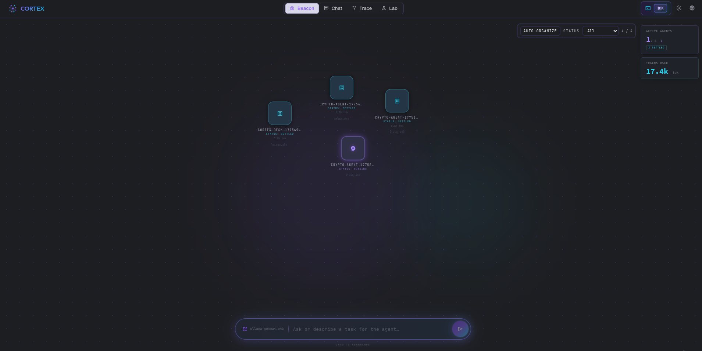
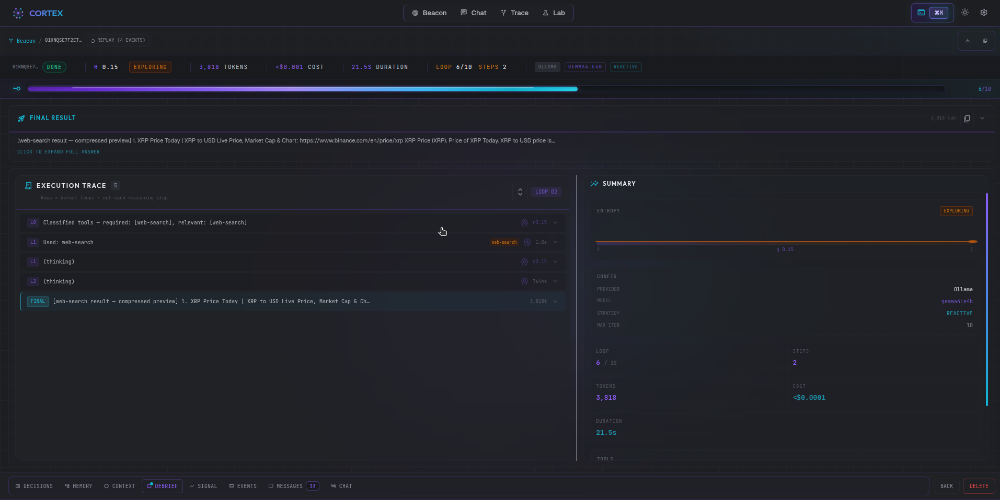
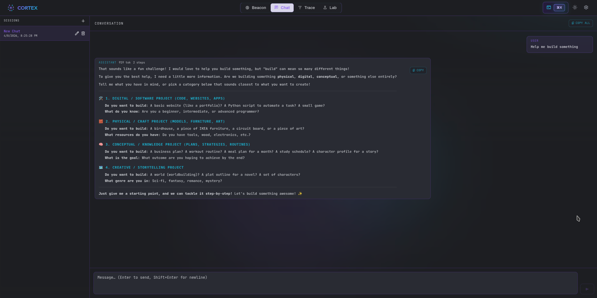

import { Tabs, TabItem, Aside, Card, CardGrid } from "@astrojs/starlight/components";

**Cortex** is the official local-first companion studio for Reactive Agents. Fire it up alongside any agent run and get an instant GUI — live reasoning traces, entropy signal charts, token/cost vitals, debrief summaries, a full trace panel, and an interactive chat interface — all persisted to SQLite so you can replay any run at any time.


## Quick Start

Start Cortex with one command, then connect any agent with one line:

<Tabs>
  <TabItem label="From npm (recommended)">
```bash
# Terminal 1 — install Cortex once, then launch the studio
bun add @reactive-agents/cortex
rax cortex
# → API + UI on http://127.0.0.1:4321 (opens in your browser automatically)

# Terminal 2 — run an agent that streams to Cortex
rax run "Research the top 5 TypeScript testing frameworks" \
 --provider anthropic \
 --reasoning \
 --tools \
 --cortex
```
  </TabItem>
  <TabItem label="From source repo (contributors)">
```bash
# Terminal 1 — clone and launch the dev stack (server + Vite UI)
git clone https://github.com/tylerjrbuell/reactive-agents-ts
cd reactive-agents-ts && bun install
bun cortex
# → API on http://localhost:4321
# → UI  on http://localhost:5173 (Vite dev mode — hot reload)

# Terminal 2 — same as above; rax stream events into the studio
rax run "Research X" --provider anthropic --cortex
```

Then connect any agent from code:

```typescript
import { ReactiveAgents } from 'reactive-agents'

const agent = await ReactiveAgents.create()
    .withProvider('anthropic')
    .withReasoning()
    .withTools({ builtins: true })
    .withCortex() // ← streams all events to http://localhost:4321
    .build()

await agent.run('Research AI agent frameworks')
```

  </TabItem>
</Tabs>

When running `rax cortex` (npm) Cortex opens your browser at `http://127.0.0.1:4321` automatically. From source-repo `bun cortex`, the Vite dev UI opens at `http://localhost:5173` (hot-reload), with the API on `:4321`.

---

## Views

Cortex has five views accessible from the top navigation bar:

### Beacon — what your agents are doing right now

Beacon is the home page. It updates over WebSocket as events stream in, and it has two views: **Board** (the default) and **Field**. Switch with the Board / Field control in the header; the choice is kept in the URL (`/?view=field`) and remembered in the browser, and the URL wins.



**Board.** *Running now* shows one card per agent that is working: its name (the run's label, saved agent, chat or task, never a bare id), where it came from (chat, gateway, desk run, app), how long it has run, its task, what it is doing now (`Calling http-get`, `Thinking after 14 tool calls`), a small entropy line with the latest value (`η 0.62`), a loop meter and `step 3 of 6 · 2.1k tok · $0.310`. Only running cards glow. A page opened mid-run fills the entropy line from the run's stored events. Below, the **Agents** grid lists every other agent with its status, source, last line (the question or approval it waits on, why it failed, or its task), model, tokens and time, filtered by **All**, **Needs you**, **Failed** and **Idle** (finished, stopped or idle).

Statuses use the same words as Runs and Chat: Running, Needs you (paused on an approval or a `request_user_input` question), Finished, Failed, Stopped, Idle.

**Field.** The free canvas: agents as nodes on a dot grid, labelled by name and status (`Calling http-get`, `Running · step 3`, `Finished`). Running nodes glow and carry one sonar ring. Sub-agents link to their parent run (linked by persisted `parentRunId`, so the hierarchy survives a reload), and a link flows only while both ends run. Nodes never overlap: each takes its own slot, sub-agents sit in the row under their parent, and the Field scrolls when the desk has more agents than one screen holds. Drag a node by its handle to move it; **Arrange** forgets your drags and groups delegation trees, then lanes by state. Dragged positions are kept per browser.

The **prompt bar** at the bottom starts a new agent in both views: the model chip opens the full agent settings for this run, the book opens the prompt library, and **Run** (or Enter) submits via `POST /api/runs` and opens the new run. Press `R` anywhere to focus it.

With no agents yet, Beacon shows a welcome with **Open a chat**, **Build an agent** and **Connect an app** (`.withCortex()`).

Under Settings · Motion, **Reduce motion** (or the system setting) stills the background, the glow, the sonar ring and the flowing links; status text still says what is running.

---

### Runs

**Runs** (`/runs`; `/run` redirects there) lists every run Cortex has seen: chat turns, desk runs from Beacon or the Lab, saved gateway agents, and any app built with `.withCortex()`. Each row shows the run's name (its label, or the chat it came from, never a bare id), where it came from, its status, model, strategy, steps, tokens, cost, time and start. Live rows update over WebSocket and carry an accent edge.

- **Waiting on you** — a strip above the list, shown only while something waits: runs paused on an approval gate (**Approve**, **Deny**, Open run or Open chat) and `request_user_input` questions (the choice buttons, Yes / No, or a short form, answered in place).
- **Stopped mid-run** — a strip shown only when a desk run with **durable runs** on was still going when Cortex stopped (the process was killed, the machine slept, a crash). Each entry says which loop it resumes after; **Resume** rebuilds the agent from the run's saved settings and continues it from its last checkpoint with the framework's `agent.resumeRun()`, on the same run, so tool calls that already finished are not run again.
- **Toolbar** — search (name, chat, agent, model, strategy), a status segment with counts (All, Running, Waiting, Finished, Failed, Stopped), sort, and the token and cost totals of the runs in view.
- **Pins and bulk delete** — pinned runs sit in their own group at the top; select rows to delete them together.
- A run stopped from the run view, or a chat turn stopped or left mid-reply, reads **Stopped**, never live or failed. **Stop** asks the agent to stop at its next step; if it is still working a few seconds later (inside a long model call), Cortex ends it the way **Terminate** does. **Terminate** aborts the run at once.
- A run paused at an approval gate or on a question reads **Waiting on you** (in Runs, the run view and Beacon), not Running. The run view header then shows the call (`Approve git commit -m "…"?`) with **Approve** and **Deny**.
- A run whose agent abstained (it declined, for example because an input was missing) reads **Abstained**, and a run that ended with part of the work done reads **Partial**, in Runs and on Beacon, not a red **Failed**. Runs recorded before this was stored are filled in from their last `AgentCompleted` event when Cortex starts.

### Compare Runs

**Compare runs** (`/runs/compare?a=&b=`) answers "what changed between these two runs", for example after you change a model, a strategy or a harness setting. Select exactly two runs in Runs and press **Compare**, or open a run and choose **Compare with…** in its More menu (runs with the same name are listed first; the open run is A).

- **Summary** — outcome, model, strategy, loops, tokens, cost, duration, output speed and time to first token for both runs, with B minus A where a number moved.
- **Config** — the settings whose resolved values differ (harness mechanisms, builder options, environment, as the run reported them on start), and how many match.
- **Steps** — when both runs recorded a trace, the framework's replay diff (`diffTraces` from `@reactive-agents/replay`) laid out by loop: loops where both runs made the same tool calls collapse into one row, a loop that differs lists each run's calls side by side, and the step where the tool sequences first part is marked.
- **Answer** — a line diff of the two final answers.

A run without a trace file (tracing off) is compared on its summary and config only, and the page says which run is missing one.

### Run View — Deep Inspection

Open any run from the Runs list, a chat turn or Beacon. The header names the run, shows its status and links back to the chat that started it; its actions are the live controls (Pause, Stop, Terminate) while it runs, **Continue in chat**, **Edit and rerun**, **Export** (run JSON, raw trace JSONL, copy the trace or the answer) and a More menu (Replay, Rerun as is, Rename, Copy run id, Delete).



#### Vitals

One wrapping line: duration, tokens (input / output on hover), cost, steps, a loop meter (`Loops 2 of 3`), entropy as `η 0.25` with a small entropy line and its trend, then the provider and model, strategy and tool-disclosure chips. The strategy is the one the run's resolved config names (else the one its loop reported), with `→ next` after a mid-run switch; the Runs list stores the same name.

#### Answer and Trace

The **Answer** panel shows the final answer as prose (long answers open as a preview with **Show all**). While the run streams it shows the output so far. A run that did not succeed opens with a banner that says how it ended: failed with its cause, abstained with its reason and what was missing, or unfinished with what was left.

**Why it ended** runs the framework's trace diagnosis over the finished run, the same engine as `rax-diagnose cause` (`analyzeCause` and `attributeFailure` from `@reactive-agents/trace`). It shows the cause in plain words with its id (`tool-failure/all-calls-failed`) and how sure the trace is, who the trace says is at fault (harness, model, environment, or cannot tell), **What to try** (the framework's next steps for that cause, the same lines `rax-diagnose cause` prints; none for a healthy run or a user stop), and the decisive steps. A step in a recorded loop opens that loop's row in the trace below. When the verdict is not decisive, the card lists the trace signals that would settle it. The card opens by itself for a failed, abstained, partial or stopped run and stays collapsed on a success. A run with no trace file (tracing off) says so.

The **Trace** panel is a step-debugger for the agent's reasoning, with two tabs:

-   **Loops** — one row per kernel loop (its reasoning, the tools it called, tokens, time and η), then the final answer. A row expands to the reasoning, action, tool result, raw model response and message thread.
-   **Timeline** — a fine-grained, chronological event stream grouped by
    kernel loop. Every discrete event is its own inspectable, expandable row:
    reasoning steps (thought / action / observation), **LLM exchanges** (system
    prompt, full message thread, native tool calls, token counts, and Anthropic
    prompt-cache hit %), tool calls, **strategy switches**, **verifier verdicts**,
    and guard firings. Filter chips (`Reasoning`, `Model calls`, `Tools`, `Control`,
    `Internal`) mute or reveal categories — internal calls (intent
    classifier, structured plan-gen) are hidden by default and one click away.
    The timeline reuses the same `TraceEvent` model as the `rax diagnose` CLI.

Both views replay from the SQLite event log; the timeline also follows replay scrub.

#### Inspector

Beside the trace on wide windows (under it below 1360px), a tab list:

| Tab           | Content                                                                                                                |
| ------------- | ---------------------------------------------------------------------------------------------------------------------- |
| **Summary**   | The run's configuration, its entropy line, the tools it called, the debrief (outcome, findings, lessons, rationale, metrics, markdown) and the launch config. The framework writes a debrief only when the agent has memory on (Memory · **Debrief after each run** turns working memory on); without one the panel says why and links the run's config in the Lab |
| **Safety**    | Every time something stepped in, in plain words and in order: a guardrail blocked or flagged input or the answer, the verifier or the result check passed or rejected the answer, the run neared or went over its budget (or the budget stopped it), the context window filled up, the model drifted from its calibration, or the controller adapted the run. Each entry names its loop (a link that opens that loop's trace row), "before the first loop" or "after the last loop". When anything fired, the header shows the count (a passed check is listed but not counted) and each affected loop row in the trace carries a badge |
| **Decisions** | Controller decision log — each Reactive Intelligence intervention: early-stop, strategy-switch, context-compress, etc. |
| **Signal**    | A D3 chart of entropy η per step (the signal gradient), tokens per loop and model latency, plus the tool calls; click a point to select its loop |
| **Context**   | The latest context-window reading                                                                                      |
| **Memory**    | The memory tiers the run loaded and flushed, then the memories this run wrote (facts, workflows, log), with links to edit them in the Lab **Memory** studio |
| **Messages**  | The full thread sent to the model, per kernel pass, with copy and JSON download                                        |
| **Events**    | All persisted `AgentEvent` objects with a readable preview each, type chips and a filter: the ground truth log        |

#### Continue in chat

There is no chat inside the run view. **Continue in chat** opens the chat that started the run, or, for any other run, creates a chat session with the run's recorded settings (provider, model, strategy, tools, workspace and the rest of its launch config), the run as context, and the run's task and answer as the first exchange. A run that recorded no settings opens with its model and your chat defaults, and a toast says so.

<Aside type="tip">
Cortex supports **replay**: close the run, reopen it later, and the trace and signal re-populate from the SQLite event log. Live streaming resumes automatically if the agent is still running. **More → Replay** steps through the stored kernel loops; the trace, signal and inspector show that slice.
</Aside>

---

### Chat — Interactive Sessions

The Chat view provides a conversational interface for multi-turn dialogue with any agent. Chats are listed in the left rail, newest first under **Today** and **Earlier**, with a search box, each chat's model and when it was last used, and a dot on the chat whose reply is running. Each row's **More actions** menu edits the chat's settings, renames it or deletes it. Opening a chat lands on its latest turn. Each chat preserves the full conversation history.

Answers read as prose (15px, a comfortable line length) with code, ids, tool names and token counts in monospace. Your messages sit on the right; the agent's turns sit on the canvas with a thin rail on the left that moves while the turn runs and turns red when it did not finish. An empty chat shows starter prompts.



Chat sessions are powered by `@reactive-agents/svelte` under the hood — the same `createCortexAgentRun` primitive that you can use in your own Svelte frontend.

Chat shows what each turn did and what it cost:

- **Turn inspector** — a resizable panel (overlay on narrow windows) with Overview, Steps and **Run trace** tabs. The Run trace tab renders the framework's real JSONL trace (Frames and Timeline views, with the timeline's category filters), with Copy and Download actions. Each run's header, main run and sub-agents alike, links to that run's page in the run view.
- **Transcript** — a turn reads as the agent replying: its prose between steps, with the tool calls in between folded into one row per group (`Ran 7`) that shows one badge per tool (`web-search ×2`, overflow as `+2`). A tool that failed gets a red badge and a `1 failed` count, and is never hidden in the overflow. Expand a group to see each call.
- **Run endings** — a turn that failed, abstained or stopped partial ends with a note saying so and why. A failed run's answer area stays empty, so harness text is never shown as the agent's answer.
- **Sub-agent cards** — delegated agents appear as compact cards under a header such as `4 agents · 1 failed`. Each card shows a status dot (running, done, failed, abstained), its goal status, `2 tools · 20s · $0.003` and one line of its latest activity. Clicking a card opens a side drawer with that agent's own transcript; Escape, the close button or a click outside closes it.
- **Turn header** — each agent turn names the model it ran on, a chip naming the strategies the run reported using (its own and its sub-agents', for example `ReAct + Reflexion`, never the configured one) and its token usage (`2.8k in · 560 out`; `~` marks a half the provider did not report, and the hover text says so without claiming it is still streaming).
- **Output speed** — beside the token usage, a live `~38 tok/s` estimate while the reply streams (from the streamed text), then the measured speed and time to first token once the model call completes (`32 tok/s · TTFT 8.7s`). Speed is output tokens over generation time, after the first token. A call that did not report when its first token came shows a lower bound marked `~` (its time includes the wait before output). The run view shows the same per loop on each trace row and the run average in its vitals line, and the Model page shows the median speed and time to first token over the model's last 20 recorded runs (lower-bound rates are never mixed into an exact median).
- **Action row** — under each message: the relative time (absolute on hover) and copy. For an assistant turn the row reads `Ran 2m 05s · finished 3 minutes ago` plus rerun, trace and fork; the buttons show on hover or focus and always on the last turn. A turn that did not finish offers **Retry** in its closing note instead. While a turn runs, a live `Running 12s` takes the place of the finish time. User messages get copy, edit and rewind.
- **Cost** — each turn's cost is persisted; the conversation total sits beside the context meter. Unknown pricing or a failed child shows "—" or "≥ $x", never a silent $0.
- **Live checklist** — a **Goals 1/2** pill in the turn footer for the run's real goal checks (gate truth, evaluated per run). The built-in "produce a substantive answer" check is hidden unless it blocked the run; a turn with only that check shows no card. The pill opens on its own while a plan runs, when a goal is unmet, or when the exit gate stopped the run. Alongside it, "Agent's to-do" (advisory, never counted toward done). Chat agents get the `todo` tool **on by default for new chat sessions** (via `chatDefaultConfig`); older sessions keep the config they were saved with.
- **Inferred progress** — a to-do the agent never ticked can still show as done when the run's ledger holds deterministic evidence for it (for example a successful tool call or written file named in the item). Those rows get a dashed check, and hovering shows `Inferred from <kind>: <detail>`. Inferred is advisory: it counts like any advisory done row, explicit marks by the agent or you win, and nothing about it is sent to the model. Pending rows left after a finished turn are labelled "not marked done". This is a display aid, not a measured improvement.
- **Conversation to-do dock** — the to-do list belongs to the conversation, not to one message. It is persisted per session, seeded into each following turn, and shown in a dock above the chat input where you can edit it. The opt-in **Keep to-do list current** setting (off by default) adds reminder and system-line guidance nudging the agent to update its list; it is experimental and its effect on to-do status updates has not been lift-measured. On `cogito:14b` (n=1) with guidance on, to-do statuses did not move.
- **Context ring** — the context-usage ring persists between runs instead of resetting to empty.
- **Model page link** — the provider and model in a turn link to `/models/<provider>/<model>`.
- **Live model pickers** — pickers list the models each provider serves right now (Anthropic, OpenAI, Gemini, Groq, xAI, Ollama, LiteLLM) and fall back to the built-in list, with a note, when discovery fails or no key is set.
- **Export** — `/export [md|json|jsonl]` or the header menu downloads the conversation.
- **Workspace skills** — every chat agent gets `.withSkills()`, so it finds the `SKILL.md` skills in its workspace (`.agents/skills`, `.claude/skills`, `.<agentId>/skills`, plus any extra folders and, only when turned on, `~/.agents/skills`) the same way a run does, and can load one itself with `activate-skill`. Without a workspace the server's launch folder is searched. The chat lists exactly those skills: a **3 skills** chip in the quick bar, and `/skill` or `/` rows with each description and the folder it came from. `/skill <name>` uses a skill for your **next message only**; `/skills <name>` pins it for every turn of the chat. You can also name a skill anywhere in a message, for example `summarize this repo /codebase-health-sweep`: a skill name the chat recognizes is highlighted as you type, and on send it is used for that message and left out of the text the agent receives (`/skill <name>` mid-message does the same, `/skills <name>` mid-message pins it). Typing `/` after a space opens the skill list at the cursor; Tab or Enter completes it. Paths such as `/usr/bin`, links, `/words` that are not skills, and anything inside backticks stay as typed; write `\/name` to send a skill name literally. Picking a skill from the menu or the skills chip puts its `/name` at the cursor and never replaces what you wrote; prompts from the prompt library also go in at the cursor. Pins are skill names, so they keep working when you change the workspace. Under each finished reply a **Skills** row shows which skills the run had loaded and why: **pinned**, **matched the task** (the framework's relevance pick) or **loaded by the agent**, with the version and a short hash of the skill body on hover, plus how many more were available. The run view shows the same row. A one-message skill is passed to that turn only; the chat keeps its agent.
- **Documents** — `/docs add <path|url>` accepts file paths and http(s) URLs; a source that fails to load emits a `DocumentIngestFailed` event, shown as a failures banner in the chat UI instead of being silently skipped. Fetched URL documents are cached per session, so re-adding the same URL does not refetch it.
- **Composer and chips** — the composer is one panel: the quick-bar chips on top, the message box, and a hint row with the prompt library and send. The goal bar (when a goal exists) docks above it. You can keep typing while a reply runs: Enter queues the next message (shown as **Queued**), it is sent when the reply finishes, and Clear or Escape drops it. If the reply stops, errors or its run fails, the queued message stays with **Send now** instead of going out. While a reply runs the send button is stop when the input is empty and queue when it has text. Starter chips, `/help`, `/docs add` and Edit put text in the composer; a draft that would be replaced is set aside behind a **Restore** toast. Restore swaps: the text it replaces is set aside in turn, with its own Restore.
- **Failed turns** — a turn whose run failed carries a **did not finish** badge and a **Run error** line with the run's cause (for example the provider's "400 Your credit balance is too low"), live and after reload. The run's failure toast shows the same line; each run gets one end toast. A turn that fails before the model answers (a model that is not pulled, a provider without a key, a refused request) keeps your message and ends the same way, with the cause and **Retry**.
- **Stopped and interrupted turns** — **Stop** ends the reply on the server: the turn reads **stopped** ("You stopped this reply before it finished.") with **Retry**. Leaving the page or closing the tab mid-reply stops the run too, and the turn reads **interrupted** with that cause when you come back. Either way the partial text and the tokens already spent are kept, and the run shows as **Stopped** in Runs instead of staying live. Chat runs a restart left open are closed when Cortex starts.
- **Waiting for the model** — between sending and the model's first token (and again after a tool call while the next model call is out) the turn reads **Waiting for the model · 12s**, or **Waiting for Ollama (loading the model or queued)** for Ollama, which loads models on demand and serves one request per model at a time. "Thinking" is shown only once the model is producing output.

#### Quick bar

The chip row above the input holds the settings you change most. Click a chip, or type its slash command, to pick a new value; the change is saved to the session and the next turn uses it. This also works while a reply runs: the change is saved straight away (not queued as a message), the running turn keeps the settings it started with, and a toast says the change applies to the next turn.

| Chip | Command | Sets |
| ---- | ------- | ---- |
| Strategy | `/strategy` | Reasoning strategy (ReAct, plan-execute, …). |
| Tools | `/tools` | Toolsets, single tools and MCP server tools. Picking any tool turns tools on for the chat. The `git` toolset (`git · gh via shell`) gives the agent a shell limited to those programs, not the full host shell; the builder's Tools picks offer it too. While it is picked, the shell-execute checkbox stays checked, so the panel matches what the agent gets; clicking it switches between `git · gh only` and the full host shell. Chats and agents saved with the removed `gh-cli` or `git-cli` tools open with the `git` toolset; a saved `gws-cli` or `workspace` pick is dropped (enable the terminal and allow `gws` instead). **Show tools: all / index / discover / tier default** sets `.withTools({ disclosure })`: how the permitted tools are shown to the model, never which are permitted. The run view shows the resolved mode and the layer that decided it (`tools: index · withTools`). |
| Shell | `/terminal` | `shell-execute`: off, on this machine, or in a Docker sandbox (no host files). |
| Workspace | `/workspace` | Directory the file tools and the shell work in. Suggestions come first (the project Cortex was started in, then workspaces you used before); **Browse folders…** opens a folder browser so you never have to type a path. The server refuses a path that is not an existing absolute directory. |
| Steps | `/iterations` | Most steps one turn may take (1 to 200; presets 4, 8, 16, 32, 64). |

Workspace and shell settings only reach the agent when the chat has tools on. A new chat has no workspace until you pick one: Cortex suggests the launch project but does not set it for you, so file tools never get write access to a directory you did not choose.

While a picker is open, clicking another chip switches straight to that picker, and clicking the same chip, clicking anywhere else or pressing Escape closes it. Whatever you had typed in the composer comes back. Multi-value pickers (tools, skills, documents) show checkboxes and stay open while you toggle several items: click or Tab toggles the highlighted row, Enter toggles it and closes. Single-value pickers (strategy, shell, steps, model) close when you pick.

#### Goals, plans and loops

These slash commands are user-started. Goals change no default and add no model-visible prompt outside a goal you start. They do not claim to improve results: a goal only supervises ordinary chat turns until a check passes or a budget runs out.

- **`/goal <objective>`** — proposes a goal: objective, derived criteria and a budget. Nothing runs until you accept the proposal in the goal bar (propose, then accept). `/goal pause`, `/goal resume`, `/goal cancel` and `/goal status` control it afterwards.
- **Verdict language** — a goal ends as achieved, stalled, blocked, budget-exhausted or cancelled. When the checks cannot decide, the verdict is `null`, shown as "not yet decided". Cortex never guesses. Criteria that are regex or must-include checks are evaluated deterministically; rubric-only criteria use one LLM call per segment, and that checker call's cost and tokens do count in the goal's `spent`. Progress comes from the run itself: a segment counts as progress when its run's assessments report new evidence (`evidenceDelta` above 0). Meta-tool-only work, such as ticking the to-do list, a failed tool call, or a tools-off reply, adds no evidence and does not count. Two segments without progress end the goal as stalled. When a segment's run reports that its exit gate denied completion (`goalAchieved: false`) or RunContract requirements are still outstanding, the goal is never called achieved, even if the criteria pass. Ordinary chat turns do not report that verdict to Cortex yet, so today this veto only applies on paths that expose it.
- **Budget** — the default is 5 segments, $1 and 200,000 tokens. Budget is checked between segments only, so a single segment can overshoot. Exhaustion ends the goal as budget-exhausted. If any turn reports no cost (for example an unpriced local model), the dollar cap cannot be enforced: the goal bar shows "cost unknown" instead of a $ meter, and the token budget is what bounds spend.
- **Session ownership** — an active goal owns its session. Plain chat messages return a 409 while the goal is active; pause or cancel it first. If you accept a goal while one of your own turns is still running, the goal waits up to 60 seconds for that turn to finish before its first segment; only if the session is still busy after that does the goal end as blocked, with the reason shown in the goal bar.
- **Resume** — a paused, stalled or blocked goal can be resumed from the goal bar (or `/goal resume`). Resuming a stalled goal clears its no-progress count; resuming a blocked goal retries the segment that failed. Resume is refused while a segment is still finishing, and for a stalled or blocked goal whose budget is already spent.
- **`/plan [task | show | hide]`** — with a task, sends it unchanged as a **planning-mode** turn (run posture `plan`; no prompt wrapper). The harness restricts that turn to planning: other tools are not available to the agent, and it records the steps on the to-do list. The composer shows a "Planning mode" badge until you send the next turn. This is a tool restriction, not a quality claim: Cortex makes no claim that plans improve results. `/plan show` and `/plan hide` toggle the plan card and to-do dock.
- **`/go`** — proceeds after planning: sends "Go ahead with the plan." as an ordinary execute turn, which ends planning mode. A plain message does the same.
- **`/loop <5m|1h> <prompt>`** and **`/schedule "<cron>" <prompt>`** — fire a prompt as an ordinary turn on a timer (`/loop stop`, `/schedule list`, `/schedule rm <id>` manage them). Schedules fire only when the session is idle: if the session is busy the fire is recorded as `skipped:busy`, and fires are also skipped while a goal is active. Every schedule expires (default 7 days, maximum 30 days), a session holds at most 3, and each fire has a $0.25 cost cap that is checked after the turn runs, so one fire can exceed it.

#### Letting the agent manage the chat (opt-in)

- **`/compact [keepLast]`** — summarises the older exchanges into one summary row. The summary follows fixed sections (Goal, Decisions, Facts & identifiers, Files & artifacts, Open questions, Next steps); a summary that does not follow them is kept under "Summary (unstructured)". Long chats are trimmed (head and tail kept) before summarising. The context meter updates to an estimate of what the next turn sends; with no known context window it shows the token estimate only. You can edit the summary text afterwards.
- **`/agent on`** ("Let the agent manage this chat") sets `agentControl: true` in the session config. It is **off by default**, per session, and `/agent off` reverts it. While on, an "Agent control" chip shows above the composer.
- **Proposals, not actions.** The agent can propose a goal, a loop or schedule, or a config change. Each proposal appears inline in the chat as a card with a summary, its arguments, and **Apply** and **Dismiss** buttons. Nothing is changed until you click Apply.
- **States.** A proposal is proposed, applied or dismissed. If an Apply fails (for example an invalid cron), the card stays pending and shows the error so you can retry or dismiss. Applying refreshes the goal bar, schedules and session config.
- **Not measured.** Whether small local models propose the right action with the right arguments has not been measured; do not assume it works reliably on them. Review each card before applying.

---

#### Environment changes between turns

A chat session can change under the model: you switch the model or thinking, add or drop tools, skills or `/docs` sources, an agent-control or goal state changes, or you add or remove rows in the agent's to-do list. When any of that differs from the end of the previous turn, the next turn carries one short, capped notice listing what changed (for example "Model changed: a to b"), and a single `environment-updated` event is recorded in the trace. When nothing changed, nothing is sent and the request is identical to a session without this feature. The diff is computed deterministically from the session config, with no model call; the tool list is derived from the session's configured tools. The notice is informational only; it is not claimed to improve answers. Set `environmentUpdates: false` in the session config to turn it off.

### Chat commands: goals, plans, loops, and schedules

In a chat, these slash commands drive longer work:

- `/goal` — propose, accept, pause, resume, cancel, or check the status of a goal. Each goal segment takes its progress from the run's own verdict.
- `/plan <task>` — sends the task with plan posture: the harness limits the turn to planning.
- `/loop` and `/schedule` — repeat work on a schedule.
- `/agent on` — opt the chat into agent session control ("let the agent manage this chat"). Off by default.
- `/tools` — the tool disclosure picker (`all`, `index`, `discover`, or tier).

A turn that pauses for approval shows an approval card in the thread, and one that asks you a question shows a reply box (Yes/No, choices, form fields, or free text). A live context meter reads the `ContextPressure` event, and a `TokenUsage` event drives the live input/output counters and the per-call strip; estimates are marked `~`. Usage details consolidate into the **Inspector's Context tab** (session, provider/model, context limit, usage, total/input/output/cache tokens, message counts, cost, timestamps, raw messages) alongside Steps and Run trace.

The chat quick bar sets strategy, tools, shell, workspace, and the per-turn step cap next to provider and model.

### Lab — Builder, Saved agents, Skills, Tools, and Prompts

The Lab (`/lab`) is the **workshop** for configuring and launching agents directly from the Cortex UI without writing code. Its header has **Import** (load an agent config JSON into the Builder), **Export** (the Builder's agent as TypeScript or JSON) and **Load example**.

The TypeScript export is the framework's own `agentConfigToSource` over the same config Cortex builds the agent from, so it matches what Cortex runs: meta tools, skills, agent tools, the host shell and its options, budgets, durable runs and the rest are all in the code. A few things Cortex adds have no config form (a scripted test scenario, host tools such as the chat's session control, Cortex's trace folder, a structured-output schema and the user-question rail of durable runs); the export lists each one that is set under **Not in this code**, with the builder call to add yourself. Secrets never appear in the code: an API key saved in Settings is left out (the note names the environment variable to set), and MCP server `env` and `headers` values print as `process.env` references. **Copy** and **Download** give you the file. Saved agents export the same way.


| Tab (URL hash)               | Purpose                                                                                                                            |
| ---------------------------- | ---------------------------------------------------------------------------------------------------------------------------------- |
| **Builder** (`/lab`)         | Three columns: a section nav with **Find a setting** (Model, Persona, Variables, Reasoning, Tools, Shell and workspace, Sub-agents, Skills, Memory, Guardrails, Execution, Reliability, Observability, All framework options; each setting has one home: approvals in **Tools**, dynamic sub-agents and nested spawning depth in **Sub-agents**, durable runs, token and cost caps, structured output and webhooks in **Execution**, documents in **Memory**, model routing in **Model**), the chosen section's settings, and **Run this agent**: On demand or Gateway process, a name, the task, a summary of what will run (model, strategy, tools, workspace), then **Save and run**, **Save** or **Run without saving** (a gateway agent: **Create gateway agent**). The **Model** section includes a **Context length (`numCtx`)** field to pin the exact provider context window (Ollama `num_ctx`); it also drives the context-usage gauge. Runs are immediately tracked in Beacon. |
| **Saved agents** (`#agents`) | Saved on-demand and gateway agents: status, schedule, runs and stats. **Run** starts one now; **Pause** / **Activate** a gateway agent; **Use in Builder**, edit, export, delete. The old `#gateway` link still opens this tab. |
| **Skills** (`#skills`)       | Two views. **Agent skills**: the skills an agent learned or loaded, kept with its memory. Pick an agent to see each skill's confidence (Tentative, Trusted, Expert), how often it was used, its success rate and when it was last used; its versions (current, on trial) with a line-by-line comparison to the version before; and a history of the skill events its runs reported (used, refined, rolled back, promoted), each linked to the run, plus the refinements and rollbacks you started in Cortex (marked "in Cortex"). **Refine now** runs one refinement pass on the agent's last model and reports how many skills were refined, unchanged, skipped (too little new evidence) or failed; **Lock** keeps a skill as it is (refinement, promotion and automatic rollback skip it) and **Unlock** lets runs evolve it again, with its versions kept either way; **Roll back** restores the previous version (`agent.rollbackSkill`); **Export to SKILL.md** writes the skill into the Builder's workspace under `.agents/skills/<name>/`. **Skill files**: the `SKILL.md` skills an agent built from the Builder can load: the framework's own search at the Builder's workspace (the server's launch folder when none is set), with each folder it looks in and whether it exists. Below them, the **Cortex library** (skills saved in Cortex's database) is deprecated: agents never see it, and **Move into agent skills** loads a row into the agent picked under Agent skills (you choose whether it evolves from runs, waits for review, or stays locked) and removes it from the library. When the agent already has a skill with that name, **Update existing** loads the row as that skill's next version and keeps its history, so you can roll it back. Pin skills by name, add extra folders and turn on home-folder skills in the Builder's **Skills** section. |
| **Memory** (`#memory`)       | An agent's stored memory, read and edited through the framework's `agent.memory()`: pick an agent (any with a memory database under `~/.reactive-agents/memory`), search facts (full text; words of 4 or more characters), browse **Facts** (semantic), **Workflows** (procedural) and **Log** (episodic). Each entry shows where it came from (the run that wrote it, with a link to that run) and its importance, tags and dates. Edit or delete facts and workflows (delete asks first). `?agent=<id>&run=<runId>` opens it narrowed to what one run wrote. |
| **Tools** (`#tools`)         | Workshop for testing individual tools — invoke any registered tool with custom parameters and inspect the result. **Create tool** adds an MCP server (manual setup or JSON import) or a custom Lab tool. |
| **Prompts** (`#prompts`)     | Reusable system prompts, personas, tasks and snippets for the Builder, chat and Beacon.                                             |

---

## Verification and host shell (Lab builder)

Cortex’s Lab **Builder** tab tracks the framework, but two options deserve a clear split:

| Control | What it does |
| ------- | ------------ |
| **Verification step → Reflect** | One extra LLM pass that reviews the draft answer (`withVerificationStep({ mode: "reflect" })`). Fast, no separate verification package. |
| **Runtime verification layer** | Enables `@reactive-agents/verification` (`withVerification`) — semantic entropy and related checks. Heavier than reflect; use when you want structured confidence signals. |

**Allowed tools** are chosen in the Lab Builder **Tools** section: quick toggles for common builtins, MCP tools from your saved servers, plus an **Additional allowed tools** field for exact IDs (Lab custom tools, less common builtins). Optional `additionalToolNames` is merged with the toggle list at run time.

**Host shell (`shell-execute`)** is **off by default**. When you enable it in **Tools**, Cortex registers the framework terminal tool with the default allowlist/blocklist. The shell options below all map to one `ShellExecuteConfig`:

| Option | What it does |
| ------ | ------------ |
| **Allowed commands** | The exact commands the agent may run, as removable chips, starting from the framework defaults. Add a command by name, or use a quick-add button (JavaScript, Python, Web, Archives, Environment) to add an opt-in group's commands. Opt-in commands are marked with a risk note. Commands added to the defaults are saved as `additionalCommands`; removing a default saves the whole list as `allowedCommands`. Configs saved with the old command groups (`commandAccess`) load into the same list. |
| **Runs on** | This machine, or a Docker sandbox with no host files (`sandbox`). |
| **Shell directory** | Directory commands start in, relative to the workspace (`cwd`). |
| **Timeout** / **Output cap** | Per-command time limit and output size; 0 keeps the framework default (30 s, 4,000 chars). |
| **Allow a shell directory outside the workspace** | Lifts the workspace confinement for `cwd` (`allowUnsafeCwd`). |

**Workspace** (top of **Tools**) sets `.withTools({ workspace })`: file tools read and write inside that directory and the shell runs in it. Type a path or press **Browse** to pick one from suggestions or a folder browser (directory names only; hidden folders behind a toggle). Leave it empty and file tools use the server's directory while the shell gets a fresh `/tmp` sandbox. A chat with tools turned off gets none of these: no shell, no workspace, no shell options, whatever its saved config holds.

**Structured output** (in **Execution**) takes a JSON Schema the answer is extracted into (`.withOutputSchema`). Once a schema is set, **If the answer does not fit the schema** picks what happens: keep the text answer and report the parse error (`degrade`, the framework default), or fail the run (`throw`).

Desk runs, chat sessions and saved gateway agents build their agents from the same config. A setting that works in one of them works in all three.

**Guardrails** has a master switch, one switch per framework detector (prompt injection, personal data, toxicity) and a **Blocked phrases** list (`customBlocklist`). The detectors are on/off; there is no sensitivity threshold.

**Approvals** (in **Tools**, and `/approvals` in chat) choose which tool calls and which shell commands wait for you. It is the framework's `approvalPolicy` (`.withApprovalPolicy({ tools, commands, mode })`), stored as is with the agent or chat:

- **Tools**: tick the tools whose every call needs approval. A shell toolset such as `git` shows as `shell-execute`; gating it asks before every shell command.
- **Shell commands**: rules such as `git push` or `gh pr create`. A rule matches by leading words: `git push` matches `git push origin main`, not `git pull`. Each part of a command joined with `&&`, `;` or `|` is checked, so `git add a && git commit -m x` matches a `git commit` rule. A bare `*` matches nothing. With the read-only `git` toolset, a rule is also what lets that git write run at all once you approve it: approving `git add … && git commit …` with only a `git commit` rule still refuses the `git add`. In chat, `/approvals add git push` adds a rule; `/approvals` lists the mode, tools and rules to toggle.
- Once anything is gated, the framework also gates every tool it marks as needing approval (`file-write`, `file-edit`, `code-execute`, and the full host shell). The editor shows those locked on.
- **When one is called**: **Pause and ask me** (`detach`) pauses the run until you approve or deny it, and turns on durable execution (a pause has to persist; the switch itself is in **Execution**). **Refuse** (`block`) decides in place; Cortex has no in-place approver, so the call does not run and the agent is told it was refused.

Configs saved before this kept the gate under **Durable execution** (`durableRuns.approvalTools`); they are read as the same policy. In chat, a gated call pauses the turn and an approval card appears in the thread showing the tool and its arguments. **Approve** runs the tool and the agent's reply lands in the thread. **Deny** (with an optional reason) resumes the run without the tool, and its reply lands the same way. **Dismiss** drops the paused turn. New messages wait until you decide. Paused chat turns also appear in the Runs page's **Waiting on you** strip, and they survive a Cortex restart as long as the session's settings are unchanged.

With durable execution on, the agent can also stop and ask you something (`request_user_input`). In chat, the question appears in the thread with a reply box: **Yes** / **No** for a confirmation, one button per option for a choice, fields for a form, or a text box. Your answer resumes the run, and the question, your answer and the agent's reply land in the thread. **Dismiss** drops the paused turn. New messages wait until you answer.

**Advanced — framework config** (in **Reasoning**) fields that are lists or maps (toolset names, focused tools, per-tool call caps, tool risk levels, required tools) use list editors: type a value and press Enter. The toolset-name suggestions for `tools.builtins` (`read`, `research`, `file`, ...) come from the framework, and `tools.disclosure` sets how permitted tools are shown.

<Aside type="caution">
**Use host shell only at your own risk.** Allowlists limit which executables may run; blocklists catch many dangerous patterns, but this is still real command execution on your host. Prefer `code-execute` or a Docker sandbox from your application when exposing agents to untrusted prompts. See [Security hardening](/guides/security-hardening/) and the shell execution docs / consumer skill for configuration details.
</Aside>

---

### Settings

Settings has a section nav on the left and one row per setting. **Save settings** writes Defaults, Providers, Notifications, Storage and Developer; Appearance applies at once.

-   **Defaults** — the provider and model that Beacon, new chats and the Lab Builder start with. A provider without its API key reads "(key missing)", and the help text names the variable to set.
-   **Providers** — one row per cloud provider (Anthropic, OpenAI, Gemini, Groq, xAI, LiteLLM) saying which key agents use, then the Ollama endpoint and whether the Cortex server is connected. **Add key** / **Replace** saves a key on the Cortex server, **Test** lists the provider's models with it (a typed key is tested before you save it), **Remove** deletes it. Saved keys are encrypted (AES-256-GCM) in `.cortex/` beside the database, in files only your user can read, and the browser only ever sees `••••` plus the last four characters. A key in the server's environment (or `.env`) wins; when both exist, **Use the saved key instead** switches to the saved one. Agents get the saved key through `.withProvider(provider, { apiKey })`, for every provider listed.
-   **Notifications** — allow desktop notifications and pick which runs notify you.
-   **Appearance** — **Theme** follows the system setting or pins dark or light (the top-bar switch pins the opposite of what is showing). **Motion** follows the system's reduced-motion setting or reduces motion in Cortex regardless: it stops the ambient drift, the logo twinkle and the live animations, and running work still shows in status text.
-   **Storage** — how long to keep runs, and **Prune now** to delete older ones. Runs live in `.cortex/cortex.db` under the server's working directory.
-   **Developer** — debug mode, hover tooltips, and how to connect an app (`.withCortex()` or `CORTEX_URL`).
-   **About** — the Cortex and framework versions. Run from a source checkout, Cortex reads the repo's `VERSION` file and shows the git commit; an installed package shows its released version.

Both themes come from one set of design tokens, so every page reads the same in either. Fonts and icons are bundled with Cortex; nothing loads from a font CDN.

The model link in a chat turn or under Defaults opens the **model page** (`/models/<provider>/<model>`): context window, max output, tool-call support and thinking, the remaining capability values, a note when the values are fallback defaults rather than measured ones (with what recorded runs on that model used), recent runs by name, and **Start a chat with this model**. Two more sections show what the model costs and how the harness adapts to it:

- **Spend** — over the model's last 50 runs in Cortex: total spend (priced by the framework when each call finished; marked `≥` when a call reported no cost), spend per successful run (all spend divided by the runs that finished with a full answer, so failed runs count against the successes), and tokens in, out and served from the prompt cache. Calls on another model inside the same runs (a fallback) are not counted.
- **Calibration** — the framework's calibration for the model, as a run with calibration on receives it: tool result size, attention to instructions, act or answer, tool classifier, parallel tool calls, shortened results and tool-call format, each in plain words with what it does and whether it is **Shipped** (the measured calibration) or **Learned** from your runs (with the shipped value it replaced). Below: how many runs the framework has observed on this model and the counts behind the learned values (learning starts at 5 runs), and the uncertainty thresholds the reactive-intelligence sensor learned from scored steps. **Strategy learning** lists, per kind of task, how each reasoning strategy did on this model as the framework's strategy chooser learned it (success estimate and runs scored, best marked; a run counts as a success when its average uncertainty stayed below 0.5), read from the calibration database. A model with no shipped calibration runs on the harness defaults, and the page says so. Cortex only reads calibration; it never changes it.

---

## Connecting Your Agent

### `.withCortex()` Builder Method

```typescript
const agent = await ReactiveAgents.create()
    .withProvider('anthropic')
    .withModel('claude-sonnet-4-6')
    .withReasoning({ defaultStrategy: 'plan-execute-reflect' })
    .withTools({ builtins: true })
    .withCortex() // ← connects to http://localhost:4321
    .withCortex('http://my-cortex:4321') // ← or explicit URL
    .build()
```

**URL resolution priority:**

1. Explicit URL passed to `.withCortex(url)`
2. `CORTEX_URL` environment variable
3. Default: `http://localhost:4321`

The connection is **best-effort** — if Cortex is not running or the WebSocket drops, the agent continues executing normally and logs a single warning. Cortex never blocks or slows down agent execution.

### What Gets Streamed

Every `AgentEvent` emitted on the internal EventBus is forwarded to Cortex over WebSocket at `/ws/ingest`. This includes:

| Event                            | What It Represents                                    |
| -------------------------------- | ----------------------------------------------------- |
| `AgentStarted`                   | Run begins — registers the agent in Beacon            |
| `AgentCompleted` / `AgentFailed` | Run ends — final status + cost                        |
| `ReasoningStepCompleted`         | One thought/action/observation triplet                |
| `ToolCallCompleted`              | Individual tool result with success/failure           |
| `FinalAnswerProduced`            | The agent's answer                                    |
| `LLMRequestCompleted`            | Token usage + cost per LLM call                       |
| `DebriefCompleted`               | Post-run structured summary                           |
| `EntropyScored`                  | Reactive Intelligence entropy measurement             |
| `ControllerDecision`             | Reactive Intelligence intervention (early-stop, etc.) |
| `ChatTurn`                       | Chat session message                                  |
| `MemoryRead` / `MemoryWrite`     | Memory layer activity                                 |
| `ProviderFallbackActivated`      | Provider fallback triggered                           |

### Environment Variables

| Variable                 | Default                 | Purpose                                                      |
| ------------------------ | ----------------------- | ------------------------------------------------------------ |
| `CORTEX_PORT`            | `4321`                  | Cortex server listen port                                    |
| `CORTEX_HOST`            | `127.0.0.1`             | Interface the server binds (loopback only by default)        |
| `CORTEX_URL`             | `http://localhost:4321` | Base URL used by `.withCortex()` if not passed explicitly    |
| `CORTEX_NO_OPEN`         | unset                   | Set to `1` to prevent opening a browser on server start      |
| `CORTEX_LOG`             | `info`                  | Server log verbosity: `error` \| `warn` \| `info` \| `debug` |
| `CORTEX_SKILL_SCAN_ROOT` | —                       | Extra folder suggested in the workspace picker (and scanned by the older `GET /api/skills/files`) |

<Aside type="caution">
Cortex has no login. By default it listens on `127.0.0.1`, so only your own computer can reach it. To use it from another machine, set `CORTEX_HOST=0.0.0.0` (or one LAN address) when you start it. Anyone who can reach that address can then browse folder names, read skill files and start agent runs, so do this only on a network you trust.
</Aside>

---

## rax CLI Integration

> **Note:** Cortex is a contributor tool, not a public CLI command. Launch it from a repo clone via `bun cortex` (or `cd apps/cortex && bun start`). The `rax run --cortex` flag still works in the published CLI — it streams events to whatever Cortex instance you have running locally.

<Tabs>
  <TabItem label="Start Cortex (repo clone)">
```bash
# Start studio with hot-reloading UI (contributor tool)
bun cortex

# Custom port (set CORTEX_PORT)

CORTEX_PORT=4444 bun cortex

# Suppress browser auto-open

CORTEX_NO_OPEN=1 bun cortex

````
  </TabItem>
  <TabItem label="Run with Cortex">
```bash
# Connect a one-off run to Cortex
rax run "Summarize the top AI news" \
  --provider anthropic \
  --reasoning \
  --tools \
  --cortex

# Custom Cortex URL
CORTEX_URL=http://cortex.internal:4321 \
  rax run "Task" --cortex --provider anthropic

# Stream output to terminal AND trace in Cortex simultaneously
rax run "Write tests for my auth module" \
  --provider anthropic \
  --reasoning \
  --tools \
  --stream \
  --cortex
````

  </TabItem>
</Tabs>

---

## Listen address and session cache

Cortex binds `127.0.0.1` by default. Change it with `rax cortex --host <addr>` or the `CORTEX_HOST` environment variable. Only expose it on a network you trust.

Cached chat agents are kept in an LRU, sized by `CORTEX_CHAT_MAX_SESSIONS` (default `8`). Builds for the same agent are single-flighted, and the cache is disposed on shutdown.

## Architecture

Cortex is a standalone application that runs alongside your agent process. It has no dependencies on the agent's runtime — communication is purely over WebSocket.

```
Your Agent Process                   Cortex Server (port 4321)
─────────────────────                ────────────────────────────
ReactiveAgentBuilder                 server/index.ts
  .withCortex()                        ├── /ws/ingest   ← receives events
      │                                │     └── CortexIngestService
      │  WebSocket (best-effort)        │           └── persists to SQLite
      └────────────────────────────────►│     └── EventBridge.broadcast()
                                       │                │
                                       ├── /ws/live/:agentId  ← fans out to UI
                                       │         ▲
                                       │         └── Browser (SvelteKit UI)
                                       │                http://localhost:5173  ← dev server URL
                                       └── /api/runs   ← REST history
```

**Server stack:** Bun + Elysia + `bun:sqlite`  
**UI stack:** SvelteKit 2, Svelte 5 (runes), Tailwind CSS, D3 for signal charts  
**Persistence:** SQLite at `.cortex/cortex.db` relative to the server process cwd

The live WebSocket at `/ws/live/:agentId` supports **replay**: on connection, the server immediately replays all persisted events for the requested `runId`, so the UI refreshes correctly even after a page reload.

---

## Integration with Web Framework Hooks

Because Cortex dogfoods `@reactive-agents/svelte`, you can use the same primitives in your own Svelte app:

```typescript
import { createRun } from '@reactive-agents/svelte'

const agentRun = createRun({
    endpoint: 'http://localhost:4321/api/agent/my-agent',
})

// Reactive Svelte store: $agentRun.status, $agentRun.output, $agentRun.iterations
```

The same pattern is available for React (`@reactive-agents/react`) and Vue (`@reactive-agents/vue`).

---

## Production Use

Cortex is designed for local development and internal tooling. For production deployments:

-   Run `bun run build:ui` inside `apps/cortex` to build the static SvelteKit bundle into `ui/build`
-   The Cortex server serves the static bundle when `CORTEX_STATIC_PATH` points to `ui/build`
-   Secure the WebSocket endpoints and REST API behind your internal network — Cortex has no authentication by default

```bash
# Build the UI for self-hosted deployment
cd apps/cortex
bun run build:ui
bun run dev:server
# → Serves static UI + API on http://localhost:4321
```

---

## Related

-   [Observability](/features/observability/) — terminal-based metrics and tracing that Cortex complements
-   [Reactive Intelligence](/features/reactive-intelligence/) — the entropy signals visualized in the Signal Monitor
-   [Rax CLI Reference](/reference/cli/#cortex-companion-studio) — `rax cortex` command reference
-   [Builder API Reference](/reference/builder-api/#optional-features) — `.withCortex(url?)` signature
