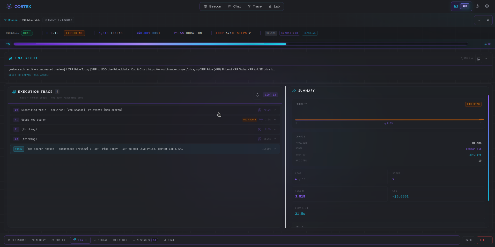
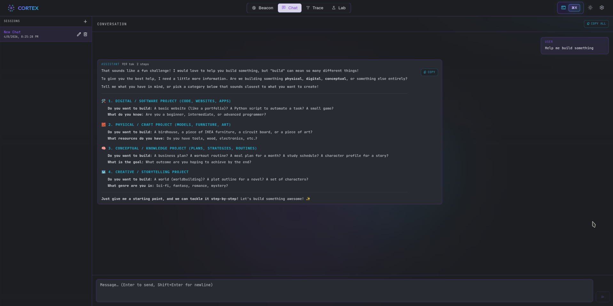

import { Tabs, TabItem, Aside, Card, CardGrid } from "@astrojs/starlight/components";

**Cortex** is the official local-first companion studio for Reactive Agents. Fire it up alongside any agent run and get an instant GUI — live reasoning traces, entropy signal charts, token/cost vitals, debrief summaries, a full trace panel, and an interactive chat interface — all persisted to SQLite so you can replay any run at any time.


## Quick Start

Start Cortex with one command, then connect any agent with one line:

<Tabs>
  <TabItem label="From npm (recommended)">
```bash
# Terminal 1 — install Cortex once, then launch the studio
bun add @reactive-agents/cortex
rax cortex
# → API + UI on http://127.0.0.1:4321 (opens in your browser automatically)

# Terminal 2 — run an agent that streams to Cortex
rax run "Research the top 5 TypeScript testing frameworks" \
 --provider anthropic \
 --reasoning \
 --tools \
 --cortex
```
  </TabItem>
  <TabItem label="From source repo (contributors)">
```bash
# Terminal 1 — clone and launch the dev stack (server + Vite UI)
git clone https://github.com/tylerjrbuell/reactive-agents-ts
cd reactive-agents-ts && bun install
bun cortex
# → API on http://localhost:4321
# → UI  on http://localhost:5173 (Vite dev mode — hot reload)

# Terminal 2 — same as above; rax stream events into the studio
rax run "Research X" --provider anthropic --cortex
```

Then connect any agent from code:

```typescript
import { ReactiveAgents } from 'reactive-agents'

const agent = await ReactiveAgents.create()
    .withProvider('anthropic')
    .withReasoning()
    .withTools({ builtins: true })
    .withCortex() // ← streams all events to http://localhost:4321
    .build()

await agent.run('Research AI agent frameworks')
```

  </TabItem>
</Tabs>

When running `rax cortex` (npm) Cortex opens your browser at `http://127.0.0.1:4321` automatically. From source-repo `bun cortex`, the Vite dev UI opens at `http://localhost:5173` (hot-reload), with the API on `:4321`.

---

## Views

Cortex has five views accessible from the top navigation bar:

### Beacon — Live Agent Grid

The Beacon view is your **agent command center**: a live grid that shows every connected agent's cognitive state in real time, updated via WebSocket as events stream in.


**Cognitive state labels** map to entropy scores from the Reactive Intelligence layer:

| State       | Meaning                                            |
| ----------- | -------------------------------------------------- |
| `running`   | Agent is actively executing — standard entropy     |
| `exploring` | Diverging entropy — agent is broadening its search |
| `stressed`  | High entropy — agent may be stuck or looping       |
| `completed` | Run finished successfully                          |
| `error`     | Run ended with an unhandled error                  |
| `idle`      | Agent is connected but not currently running       |

Beacon shows delegation: sub-agents nest under their parent run (linked by persisted `parentRunId`, so the hierarchy survives a reload), including runs spawned from Chat. Grid layout is deterministic, and node positions you drag are persisted per browser.

The filter bar (`All`, `Running`, `Exploring`, `Stressed`, …) lets you focus on agents of interest. The **bottom input bar** submits a new prompt via `POST /api/runs` and navigates directly to the new run on success.

---

### Run View — Deep Inspection

Navigate to any run from the Beacon grid or the Runs list. The Run View is the core diagnostic surface in Cortex: a multi-panel interface combining real-time streaming and persistent replay.



#### Vitals Strip

Always-visible run metadata: iteration count, total duration, tokens used, estimated cost, LLM provider, model, and reasoning strategy selected.

#### Entropy Signal Monitor

A D3-powered chart tracking the composite entropy score across all iterations. Entropy encodes reasoning quality — a converging trace (`↘`) indicates healthy progress toward an answer; a flat or diverging trace flags loops or confusion. The chart updates live while the run is in progress, and is fully replayable from history.

#### Trace Panel

A step-debugger for the agent's reasoning, with two views (toggle at the top):

-   **Timeline** (default) — a fine-grained, chronological event stream grouped by
    kernel iteration. Every discrete event is its own inspectable, expandable row:
    reasoning steps (thought / action / observation), **LLM exchanges** (system
    prompt, full message thread, native tool calls, token counts, and Anthropic
    prompt-cache hit %), tool calls, **strategy switches**, **verifier verdicts**,
    and guard firings. Filter chips (`Reasoning`, `LLM calls`, `Tools`, `Control`,
    `Aux/internal`) mute or reveal categories — aux/internal calls (intent
    classifier, structured plan-gen) are hidden by default and one click away.
    The timeline reuses the same `TraceEvent` model as the `rax diagnose` CLI.
-   **Frames** — the classic per-iteration view: collapsible **Thought / Action /
    Observation** frames, each time-stamped and indexed.

Both views replay from the SQLite event log; the timeline also follows replay scrub.

#### Bottom Tabs

| Tab            | Content                                                                                                                |
| -------------- | ---------------------------------------------------------------------------------------------------------------------- |
| **Debrief**    | Structured post-run summary: task, plan, outcome, sources, confidence, and self-critique                               |
| **Decisions**  | Controller decision log — each Reactive Intelligence intervention: early-stop, strategy-switch, context-compress, etc. |
| **Memory**     | Memory entries read and written during this run (working, semantic, episodic, procedural)                              |
| **Context**    | Full context window snapshot at each iteration                                                                         |
| **Raw Events** | All persisted `AgentEvent` objects with timestamps — the ground truth log                                              |
| **Chat**       | Open a follow-up conversation with the same agent using this run as context                                            |

<Aside type="tip">
Cortex supports **replay**: close the run, reopen it later, and the Trace Panel and Signal Monitor re-populate from the SQLite event log. Live streaming resumes automatically if the agent is still running.
</Aside>

---

### Chat — Interactive Sessions

The Chat view provides a conversational interface for multi-turn dialogue with any agent. Sessions are listed in the left panel; each session preserves the full conversation history.



Chat sessions are powered by `@reactive-agents/svelte` under the hood — the same `createCortexAgentRun` primitive that you can use in your own Svelte frontend.

Chat shows what each turn did and what it cost:

- **Turn inspector** — a resizable panel (overlay on narrow windows) with Overview, Steps and **Run trace** tabs. The Run trace tab renders the framework's real JSONL trace, with Copy and Download actions.
- **Sub-agent blocks** — delegated agents appear as expandable blocks with a live preview, tool count, elapsed time and cost; parallel children stack in start order and grandchildren nest.
- **Cost** — each turn's cost is persisted; the conversation total sits beside the context meter. Unknown pricing or a failed child shows "—" or "≥ $x", never a silent $0.
- **Live checklist** — a plan card with "Goal checks" (gate truth, evaluated per run) and "Agent's to-do" (advisory, never counted toward done). Chat agents get the `todo` tool **on by default for new chat sessions** (via `chatDefaultConfig`); older sessions keep the config they were saved with.
- **Inferred progress** — a to-do the agent never ticked can still show as done when the run's ledger holds deterministic evidence for it (for example a successful tool call or written file named in the item). Those rows get a dashed check, and hovering shows `Inferred from <kind>: <detail>`. Inferred is advisory: it counts like any advisory done row, explicit marks by the agent or you win, and nothing about it is sent to the model. Pending rows left after a finished turn are labelled "not marked done". This is a display aid, not a measured improvement.
- **Conversation to-do dock** — the to-do list belongs to the conversation, not to one message. It is persisted per session, seeded into each following turn, and shown in a dock above the chat input where you can edit it. The opt-in **Keep to-do list current** setting (off by default) adds reminder and system-line guidance nudging the agent to update its list; it is experimental and its effect on to-do status updates has not been lift-measured. On `cogito:14b` (n=1) with guidance on, to-do statuses did not move.
- **Context ring** — the context-usage ring persists between runs instead of resetting to empty.
- **Model page link** — the provider and model in a turn link to `/models/<provider>/<model>`.
- **Live model pickers** — pickers list the models each provider serves right now (Anthropic, OpenAI, Gemini, Groq, xAI, Ollama, LiteLLM) and fall back to the built-in list, with a note, when discovery fails or no key is set.
- **Export** — `/export [md|json|jsonl]` or the header menu downloads the conversation.
- **Documents** — `/docs add <path|url>` accepts file paths and http(s) URLs; a source that fails to load emits a `DocumentIngestFailed` event, shown as a failures banner in the chat UI instead of being silently skipped. Fetched URL documents are cached per session, so re-adding the same URL does not refetch it.
- **Composer and chips** — the composer shows prompt, provider and model chips above the input, with the goal bar (when a goal exists) docked over it.

#### Quick bar

The chip row above the input holds the settings you change most. Click a chip, or type its slash command, to pick a new value; the change is saved to the session and the next turn uses it.

| Chip | Command | Sets |
| ---- | ------- | ---- |
| Strategy | `/strategy` | Reasoning strategy (ReAct, plan-execute, …). |
| Tools | `/tools` | Toolsets, single tools and MCP server tools. Picking any tool turns tools on for the chat. |
| Shell | `/terminal` | `shell-execute`: off, on this machine, or in a Docker sandbox (no host files). |
| Workspace | `/workspace` | Directory the file tools and the shell work in. The server refuses a path that is not an existing absolute directory. |
| Steps | `/iterations` | Most steps one turn may take (1 to 200; presets 4, 8, 16, 32, 64). |

Workspace and shell settings only reach the agent when the chat has tools on.

#### Goals, plans and loops

These slash commands are user-started. Goals change no default and add no model-visible prompt outside a goal you start. They do not claim to improve results: a goal only supervises ordinary chat turns until a check passes or a budget runs out.

- **`/goal <objective>`** — proposes a goal: objective, derived criteria and a budget. Nothing runs until you accept the proposal in the goal bar (propose, then accept). `/goal pause`, `/goal resume`, `/goal cancel` and `/goal status` control it afterwards.
- **Verdict language** — a goal ends as achieved, stalled, blocked, budget-exhausted or cancelled. When the checks cannot decide, the verdict is `null`, shown as "not yet decided". Cortex never guesses. Criteria that are regex or must-include checks are evaluated deterministically; rubric-only criteria use one LLM call per segment, and that checker call's cost and tokens do count in the goal's `spent`. Progress comes from the run itself: a segment counts as progress when its run's assessments report new evidence (`evidenceDelta` above 0). Meta-tool-only work, such as ticking the to-do list, a failed tool call, or a tools-off reply, adds no evidence and does not count. Two segments without progress end the goal as stalled. When a segment's run reports that its exit gate denied completion (`goalAchieved: false`) or RunContract requirements are still outstanding, the goal is never called achieved, even if the criteria pass. Ordinary chat turns do not report that verdict to Cortex yet, so today this veto only applies on paths that expose it.
- **Budget** — the default is 5 segments, $1 and 200,000 tokens. Budget is checked between segments only, so a single segment can overshoot. Exhaustion ends the goal as budget-exhausted. If any turn reports no cost (for example an unpriced local model), the dollar cap cannot be enforced: the goal bar shows "cost unknown" instead of a $ meter, and the token budget is what bounds spend.
- **Session ownership** — an active goal owns its session. Plain chat messages return a 409 while the goal is active; pause or cancel it first. If you accept a goal while one of your own turns is still running, the goal waits up to 60 seconds for that turn to finish before its first segment; only if the session is still busy after that does the goal end as blocked, with the reason shown in the goal bar.
- **Resume** — a paused, stalled or blocked goal can be resumed from the goal bar (or `/goal resume`). Resuming a stalled goal clears its no-progress count; resuming a blocked goal retries the segment that failed. Resume is refused while a segment is still finishing, and for a stalled or blocked goal whose budget is already spent.
- **`/plan [task | show | hide]`** — with a task, sends it unchanged as a **planning-mode** turn (run posture `plan`; no prompt wrapper). The harness restricts that turn to planning: other tools are not available to the agent, and it records the steps on the to-do list. The composer shows a "Planning mode" badge until you send the next turn. This is a tool restriction, not a quality claim: Cortex makes no claim that plans improve results. `/plan show` and `/plan hide` toggle the plan card and to-do dock.
- **`/go`** — proceeds after planning: sends "Go ahead with the plan." as an ordinary execute turn, which ends planning mode. A plain message does the same.
- **`/loop <5m|1h> <prompt>`** and **`/schedule "<cron>" <prompt>`** — fire a prompt as an ordinary turn on a timer (`/loop stop`, `/schedule list`, `/schedule rm <id>` manage them). Schedules fire only when the session is idle: if the session is busy the fire is recorded as `skipped:busy`, and fires are also skipped while a goal is active. Every schedule expires (default 7 days, maximum 30 days), a session holds at most 3, and each fire has a $0.25 cost cap that is checked after the turn runs, so one fire can exceed it.

#### Letting the agent manage the chat (opt-in)

- **`/agent on`** ("Let the agent manage this chat") sets `agentControl: true` in the session config. It is **off by default**, per session, and `/agent off` reverts it. While on, an "Agent control" chip shows above the composer.
- **Proposals, not actions.** The agent can propose a goal, a loop or schedule, or a config change. Each proposal appears inline in the chat as a card with a summary, its arguments, and **Apply** and **Dismiss** buttons. Nothing is changed until you click Apply.
- **States.** A proposal is proposed, applied or dismissed. If an Apply fails (for example an invalid cron), the card stays pending and shows the error so you can retry or dismiss. Applying refreshes the goal bar, schedules and session config.
- **Not measured.** Whether small local models propose the right action with the right arguments has not been measured; do not assume it works reliably on them. Review each card before applying.

---

#### Environment changes between turns

A chat session can change under the model: you switch the model or thinking, add or drop tools, skills or `/docs` sources, an agent-control or goal state changes, or you add or remove rows in the agent's to-do list. When any of that differs from the end of the previous turn, the next turn carries one short, capped notice listing what changed (for example "Model changed: a to b"), and a single `environment-updated` event is recorded in the trace. When nothing changed, nothing is sent and the request is identical to a session without this feature. The diff is computed deterministically from the session config, with no model call; the tool list is derived from the session's configured tools. The notice is informational only; it is not claimed to improve answers. Set `environmentUpdates: false` in the session config to turn it off.

### Lab — Builder, Skills, Tools, and Gateway

The Lab view is the **workshop** for configuring and launching agents directly from the Cortex UI without writing code:


| Tab         | Purpose                                                                                                                            |
| ----------- | ---------------------------------------------------------------------------------------------------------------------------------- |
| **Builder** | Visual agent configurator — choose provider, model, capabilities, and submit a prompt. The **Inference** section includes a **Context length (`numCtx`)** field to pin the exact provider context window (Ollama `num_ctx`); it also drives the context-usage gauge. Runs are immediately tracked in Beacon. |
| **Gateway** | Manage persistent gateway agents: list all saved agents, see their status, last run time, and schedule. Start/stop on demand.      |
| **Skills**  | Browse all `SKILL.md` files discovered in the workspace and stored in SQLite. View skill content, metadata, and evolution history. |
| **Tools**   | Workshop for testing individual tools — invoke any registered tool with custom parameters and inspect the result.                  |

---

## Verification and host shell (Lab builder)

Cortex’s Lab **Builder** tab tracks the framework, but two options deserve a clear split:

| Control | What it does |
| ------- | ------------ |
| **Verification step → Reflect** | One extra LLM pass that reviews the draft answer (`withVerificationStep({ mode: "reflect" })`). Fast, no separate verification package. |
| **Runtime verification layer** | Enables `@reactive-agents/verification` (`withVerification`) — semantic entropy and related checks. Heavier than reflect; use when you want structured confidence signals. |

**Allowed tools** are chosen in the Lab Builder **Tools** section: quick toggles for common builtins, MCP tools from your saved servers, plus an **Additional allowed tools** field for exact IDs (Lab custom tools, less common builtins). Optional `additionalToolNames` is merged with the toggle list at run time.

**Host shell (`shell-execute`)** is **off by default**. When you enable it in **Tools**, Cortex registers the framework terminal tool with the default allowlist/blocklist. You can add **extra allowed command names** (e.g. `node`, `gh`) or, for advanced setups, **replace the entire allowlist** from the same Tools panel. The shell options below all map to one `ShellExecuteConfig`:

| Option | What it does |
| ------ | ------------ |
| **Command groups** | Opt-in command sets (for example GitHub CLI) added to the allowlist (`commandAccess`). |
| **Runs on** | This machine, or a Docker sandbox with no host files (`sandbox`). |
| **Shell directory** | Directory commands start in, relative to the workspace (`cwd`). |
| **Timeout** / **Output cap** | Per-command time limit and output size; 0 keeps the framework default (30 s, 4,000 chars). |
| **Allow a shell directory outside the workspace** | Lifts the workspace confinement for `cwd` (`allowUnsafeCwd`). |

**Workspace** (top of **Tools**) sets `.withTools({ workspace })`: file tools read and write inside that directory and the shell runs in it. Leave it empty and file tools use the server's directory while the shell gets a fresh `/tmp` sandbox.

**Guardrails** has a master switch, one switch per framework detector (prompt injection, personal data, toxicity) and a **Blocked phrases** list (`customBlocklist`). The detectors are on/off; there is no sensitivity threshold.

**Durable execution** (in **Reasoning**) can gate chosen tools behind approval. **When a gated tool is called** picks the mode: pause the run and resume it after approval (`detach`), or wait in place until approved (`block`). In chat, a gated tool pauses the turn, but Cortex does not yet offer approve or deny for a paused chat turn; use gated tools from Lab runs.

**Advanced — framework config** (in **Reasoning**) fields that are lists or maps (toolset names, focused tools, per-tool call caps, tool risk levels, required tools) use list editors: type a value and press Enter.

<Aside type="caution">
**Use host shell only at your own risk.** Allowlists limit which executables may run; blocklists catch many dangerous patterns, but this is still real command execution on your host. Prefer `code-execute` or a Docker sandbox from your application when exposing agents to untrusted prompts. See [Security hardening](/guides/security-hardening/) and the shell execution docs / consumer skill for configuration details.
</Aside>

---

### Settings

Configure global Cortex defaults:

-   **Default provider and model** — used as the pre-fill in the Lab Builder
-   **Ollama endpoint** — custom local Ollama server URL
-   **UI theme** — light / dark / system
-   **Notifications** — enable / disable toast notifications
-   **Storage** — view current SQLite path and database size

---

## Connecting Your Agent

### `.withCortex()` Builder Method

```typescript
const agent = await ReactiveAgents.create()
    .withProvider('anthropic')
    .withModel('claude-sonnet-4-6')
    .withReasoning({ defaultStrategy: 'plan-execute-reflect' })
    .withTools({ builtins: true })
    .withCortex() // ← connects to http://localhost:4321
    .withCortex('http://my-cortex:4321') // ← or explicit URL
    .build()
```

**URL resolution priority:**

1. Explicit URL passed to `.withCortex(url)`
2. `CORTEX_URL` environment variable
3. Default: `http://localhost:4321`

The connection is **best-effort** — if Cortex is not running or the WebSocket drops, the agent continues executing normally and logs a single warning. Cortex never blocks or slows down agent execution.

### What Gets Streamed

Every `AgentEvent` emitted on the internal EventBus is forwarded to Cortex over WebSocket at `/ws/ingest`. This includes:

| Event                            | What It Represents                                    |
| -------------------------------- | ----------------------------------------------------- |
| `AgentStarted`                   | Run begins — registers the agent in Beacon            |
| `AgentCompleted` / `AgentFailed` | Run ends — final status + cost                        |
| `ReasoningStepCompleted`         | One thought/action/observation triplet                |
| `ToolCallCompleted`              | Individual tool result with success/failure           |
| `FinalAnswerProduced`            | The agent's answer                                    |
| `LLMRequestCompleted`            | Token usage + cost per LLM call                       |
| `DebriefCompleted`               | Post-run structured summary                           |
| `EntropyScored`                  | Reactive Intelligence entropy measurement             |
| `ControllerDecision`             | Reactive Intelligence intervention (early-stop, etc.) |
| `ChatTurn`                       | Chat session message                                  |
| `MemoryRead` / `MemoryWrite`     | Memory layer activity                                 |
| `ProviderFallbackActivated`      | Provider fallback triggered                           |

### Environment Variables

| Variable                 | Default                 | Purpose                                                      |
| ------------------------ | ----------------------- | ------------------------------------------------------------ |
| `CORTEX_PORT`            | `4321`                  | Cortex server listen port                                    |
| `CORTEX_URL`             | `http://localhost:4321` | Base URL used by `.withCortex()` if not passed explicitly    |
| `CORTEX_NO_OPEN`         | unset                   | Set to `1` to prevent opening a browser on server start      |
| `CORTEX_LOG`             | `info`                  | Server log verbosity: `error` \| `warn` \| `info` \| `debug` |
| `CORTEX_SKILL_SCAN_ROOT` | —                       | Extra root path to scan for `SKILL.md` files in Lab/Skills   |

---

## rax CLI Integration

> **Note:** Cortex is a contributor tool, not a public CLI command. Launch it from a repo clone via `bun cortex` (or `cd apps/cortex && bun start`). The `rax run --cortex` flag still works in the published CLI — it streams events to whatever Cortex instance you have running locally.

<Tabs>
  <TabItem label="Start Cortex (repo clone)">
```bash
# Start studio with hot-reloading UI (contributor tool)
bun cortex

# Custom port (set CORTEX_PORT)

CORTEX_PORT=4444 bun cortex

# Suppress browser auto-open

CORTEX_NO_OPEN=1 bun cortex

````
  </TabItem>
  <TabItem label="Run with Cortex">
```bash
# Connect a one-off run to Cortex
rax run "Summarize the top AI news" \
  --provider anthropic \
  --reasoning \
  --tools \
  --cortex

# Custom Cortex URL
CORTEX_URL=http://cortex.internal:4321 \
  rax run "Task" --cortex --provider anthropic

# Stream output to terminal AND trace in Cortex simultaneously
rax run "Write tests for my auth module" \
  --provider anthropic \
  --reasoning \
  --tools \
  --stream \
  --cortex
````

  </TabItem>
</Tabs>

---

## Architecture

Cortex is a standalone application that runs alongside your agent process. It has no dependencies on the agent's runtime — communication is purely over WebSocket.

```
Your Agent Process                   Cortex Server (port 4321)
─────────────────────                ────────────────────────────
ReactiveAgentBuilder                 server/index.ts
  .withCortex()                        ├── /ws/ingest   ← receives events
      │                                │     └── CortexIngestService
      │  WebSocket (best-effort)        │           └── persists to SQLite
      └────────────────────────────────►│     └── EventBridge.broadcast()
                                       │                │
                                       ├── /ws/live/:agentId  ← fans out to UI
                                       │         ▲
                                       │         └── Browser (SvelteKit UI)
                                       │                http://localhost:5173  ← dev server URL
                                       └── /api/runs   ← REST history
```

**Server stack:** Bun + Elysia + `bun:sqlite`  
**UI stack:** SvelteKit 2, Svelte 5 (runes), Tailwind CSS, D3 for signal charts  
**Persistence:** SQLite at `.cortex/cortex.db` relative to the server process cwd

The live WebSocket at `/ws/live/:agentId` supports **replay**: on connection, the server immediately replays all persisted events for the requested `runId`, so the UI refreshes correctly even after a page reload.

---

## Integration with Web Framework Hooks

Because Cortex dogfoods `@reactive-agents/svelte`, you can use the same primitives in your own Svelte app:

```typescript
import { createRun } from '@reactive-agents/svelte'

const agentRun = createRun({
    endpoint: 'http://localhost:4321/api/agent/my-agent',
})

// Reactive Svelte store: $agentRun.status, $agentRun.output, $agentRun.iterations
```

The same pattern is available for React (`@reactive-agents/react`) and Vue (`@reactive-agents/vue`).

---

## Production Use

Cortex is designed for local development and internal tooling. For production deployments:

-   Run `bun run build:ui` inside `apps/cortex` to build the static SvelteKit bundle into `ui/build`
-   The Cortex server serves the static bundle when `CORTEX_STATIC_PATH` points to `ui/build`
-   Secure the WebSocket endpoints and REST API behind your internal network — Cortex has no authentication by default

```bash
# Build the UI for self-hosted deployment
cd apps/cortex
bun run build:ui
bun run dev:server
# → Serves static UI + API on http://localhost:4321
```

---

## Related

-   [Observability](/features/observability/) — terminal-based metrics and tracing that Cortex complements
-   [Reactive Intelligence](/features/reactive-intelligence/) — the entropy signals visualized in the Signal Monitor
-   [Rax CLI Reference](/reference/cli/#cortex-contributor-tool) — Cortex contributor-tool reference
-   [Builder API Reference](/reference/builder-api/#optional-features) — `.withCortex(url?)` signature
