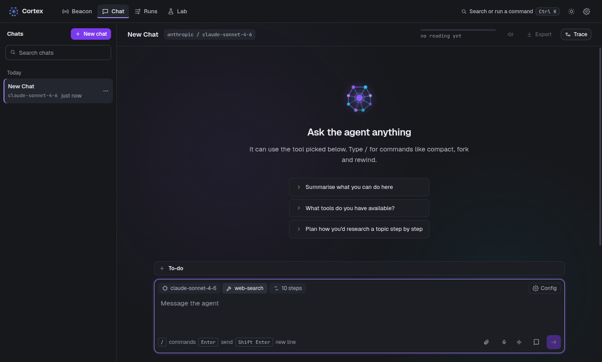
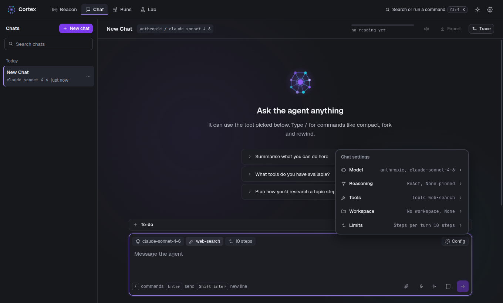

import { Aside } from "@astrojs/starlight/components";

The Chat view provides a conversational interface for multi-turn dialogue with any agent. Chats are listed in the left rail, newest first under **Today** and **Earlier**, with a search box, each chat's model and when it was last used, and a dot on the chat whose reply is running. Each row's **More actions** menu edits the chat's settings, renames it or deletes it. Opening a chat lands on its latest turn. Each chat preserves the full conversation history.

Answers read as prose (15px, a comfortable line length) with code, ids, tool names and token counts in monospace. Your messages sit on the right; the agent's turns sit on the canvas with a thin rail on the left that moves while the turn runs and turns red when it did not finish. An empty chat shows starter prompts.

Chat sessions are powered by `@reactive-agents/svelte` under the hood — the same `createCortexAgentRun` primitive that you can use in your own Svelte frontend.

Chat shows what each turn did and what it cost:

- **Turn inspector** — a resizable panel (overlay on narrow windows) with Overview, Steps and **Run trace** tabs. The Run trace tab renders the framework's real JSONL trace (Frames and Timeline views, with the timeline's category filters), with Copy and Download actions. Each run's header, main run and sub-agents alike, links to that run's page in the run view.
- **Transcript** — a turn reads as the agent replying: its prose between steps, with the tool calls in between folded into one row per group (`Ran 7`) that shows one badge per tool (`web-search ×2`, overflow as `+2`). A tool that failed gets a red badge and a `1 failed` count, and is never hidden in the overflow. Expand a group to see each call.
- **Run endings** — a turn that failed, abstained or stopped partial ends with a note saying so and why. A failed run's answer area stays empty, so harness text is never shown as the agent's answer.
- **Sub-agent cards** — delegated agents appear as compact cards under a header such as `4 agents · 1 failed`. Each card shows a status dot (running, done, failed, abstained), its goal status, `2 tools · 20s · $0.003` and one line of its latest activity. Clicking a card opens a side drawer with that agent's own transcript; Escape, the close button or a click outside closes it.
- **Turn header** — each agent turn names the model it ran on, a chip naming the strategies the run reported using (its own and its sub-agents', for example `ReAct + Reflexion`, never the configured one) and its token usage (`2.8k in · 560 out`; `~` marks a half the provider did not report, and the hover text says so without claiming it is still streaming).
- **Output speed** — beside the token usage, a live `~38 tok/s` estimate while the reply streams (from the streamed text), then the measured speed and time to first token once the model call completes (`32 tok/s · TTFT 8.7s`). Speed is output tokens over generation time, after the first token. A call that did not report when its first token came shows a lower bound marked `~` (its time includes the wait before output). The run view shows the same per loop on each trace row and the run average in its vitals line, and the Model page shows the median speed and time to first token over the model's last 20 recorded runs (lower-bound rates are never mixed into an exact median).
- **Action row** — under each message: the relative time (absolute on hover) and copy. For an assistant turn the row reads `Ran 2m 05s · finished 3 minutes ago` plus rerun, trace and fork; the buttons show on hover or focus and always on the last turn. A turn that did not finish offers **Retry** in its closing note instead. While a turn runs, a live `Running 12s` takes the place of the finish time. User messages get copy, edit and rewind.
- **Cost** — each turn's cost is persisted; the conversation total sits beside the context meter. Unknown pricing or a failed child shows "—" or "≥ $x", never a silent $0.
- **Live checklist** — a **Goals 1/2** pill in the turn footer for the run's real goal checks (gate truth, evaluated per run). The built-in "produce a substantive answer" check is hidden unless it blocked the run; a turn with only that check shows no card. The pill opens on its own while a plan runs, when a goal is unmet, or when the exit gate stopped the run. Alongside it, "Agent's to-do" (advisory, never counted toward done). Chat agents get the `todo` tool **on by default for new chat sessions** (via `chatDefaultConfig`); older sessions keep the config they were saved with.
- **Inferred progress** — a to-do the agent never ticked can still show as done when the run's ledger holds deterministic evidence for it (for example a successful tool call or written file named in the item). Those rows get a dashed check, and hovering shows `Inferred from <kind>: <detail>`. Inferred is advisory: it counts like any advisory done row, explicit marks by the agent or you win, and nothing about it is sent to the model. Pending rows left after a finished turn are labelled "not marked done". This is a display aid, not a measured improvement.
- **Conversation to-do dock** — the to-do list belongs to the conversation, not to one message. It is persisted per session, seeded into each following turn, and shown in a dock above the chat input where you can edit it. The opt-in **Keep to-do list current** setting (off by default) adds reminder and system-line guidance nudging the agent to update its list; it is experimental and its effect on to-do status updates has not been lift-measured. On `cogito:14b` (n=1) with guidance on, to-do statuses did not move.
- **Context ring** — the context-usage ring persists between runs instead of resetting to empty.
- **Model page link** — the provider and model in a turn link to `/models/<provider>/<model>`.
- **Live model pickers** — pickers list the models each provider serves right now (Anthropic, OpenAI, Gemini, Groq, xAI, Ollama, LiteLLM) and fall back to the built-in list, with a note, when discovery fails or no key is set.
- **Export** — `/export [md|json|jsonl]` or the header menu downloads the conversation.
- **Workspace skills** — every chat agent gets `.withSkills()`, so it finds the `SKILL.md` skills in its workspace (`.agents/skills`, `.claude/skills`, `.<agentId>/skills`, plus any extra folders and, only when turned on, `~/.agents/skills`) the same way a run does, and can load one itself with `activate-skill`. Without a workspace the server's launch folder is searched. The chat lists exactly those skills: a **3 skills** chip in the quick bar, and `/skill` or `/` rows with each description and the folder it came from. `/skill <name>` uses a skill for your **next message only**; `/skills <name>` pins it for every turn of the chat. You can also name a skill anywhere in a message, for example `summarize this repo /codebase-health-sweep`: a skill name the chat recognizes is highlighted as you type, and on send it is used for that message and left out of the text the agent receives (`/skill <name>` mid-message does the same, `/skills <name>` mid-message pins it). Typing `/` after a space opens the skill list at the cursor; Tab or Enter completes it. Paths such as `/usr/bin`, links, `/words` that are not skills, and anything inside backticks stay as typed; write `\/name` to send a skill name literally. Picking a skill from the menu or the skills chip puts its `/name` at the cursor and never replaces what you wrote; prompts from the prompt library also go in at the cursor. Pins are skill names, so they keep working when you change the workspace. Under each finished reply a **Skills** row shows which skills the run had loaded and why: **pinned**, **matched the task** (the framework's relevance pick) or **loaded by the agent**, with the version and a short hash of the skill body on hover, plus how many more were available. The run view shows the same row. A one-message skill is passed to that turn only; the chat keeps its agent.
- **Documents** — `/docs add <path|url>` accepts file paths and http(s) URLs; a source that fails to load emits a `DocumentIngestFailed` event, shown as a failures banner in the chat UI instead of being silently skipped. Fetched URL documents are cached per session, so re-adding the same URL does not refetch it.
- **Composer and chips** — the composer is one panel: the quick-bar chips on top, the message box, and a hint row with the prompt library and send. The goal bar (when a goal exists) docks above it. You can keep typing while a reply runs: Enter queues the next message (shown as **Queued**), it is sent when the reply finishes, and Clear or Escape drops it. If the reply stops, errors or its run fails, the queued message stays with **Send now** instead of going out. While a reply runs the send button is stop when the input is empty and queue when it has text. Starter chips, `/help`, `/docs add` and Edit put text in the composer; a draft that would be replaced is set aside behind a **Restore** toast. Restore swaps: the text it replaces is set aside in turn, with its own Restore.
- **Failed turns** — a turn whose run failed carries a **did not finish** badge and a **Run error** line with the run's cause (for example the provider's "400 Your credit balance is too low"), live and after reload. The run's failure toast shows the same line; each run gets one end toast. A turn that fails before the model answers (a model that is not pulled, a provider without a key, a refused request) keeps your message and ends the same way, with the cause and **Retry**.
- **Stopped and interrupted turns** — **Stop** ends the reply on the server: the turn reads **stopped** ("You stopped this reply before it finished.") with **Retry**. Leaving the page or closing the tab mid-reply stops the run too, and the turn reads **interrupted** with that cause when you come back. Either way the partial text and the tokens already spent are kept, and the run shows as **Stopped** in Runs instead of staying live. Chat runs a restart left open are closed when Cortex starts.
- **Waiting for the model** — between sending and the model's first token (and again after a tool call while the next model call is out) the turn reads **Waiting for the model · 12s**, or **Waiting for Ollama (loading the model or queued)** for Ollama, which loads models on demand and serves one request per model at a time. "Thinking" is shown only once the model is producing output.

## The quick bar and Config popover

The composer has **one command surface**. Typing `/` and pressing the **Config** button open the same list, anchored to the composer. Every setting appears there next to its slash alias (`/model`, `/tools`, `/agent`, `/approvals`, ...) and its current value, so you can learn the command while you click. A command with options opens in place under a **Back** row. **Esc** goes back one level, then closes the list. `/agent` has an On/Off panel.

The row above the input shows the model and only the settings that differ from the defaults: a thinking choice, a strategy other than ReAct, a step cap other than 16, tools, the shell, a workspace, pinned skills, documents, agent control. At most four chips show; the **Config** button (with `+N` for changed settings that did not fit) opens a popover anchored to the button. It starts on a menu of the five groups, each with a one-line summary: Model (provider, model, thinking), Reasoning (strategy, skills, agent control), Tools (tools, shell, MCP servers, tool disclosure, approvals), Workspace (directory, documents) and Limits (steps). Choose a group to see its rows with their current values; a header row holds **Back** and the group's name. A row opens the same picker as its slash command, with its own Back row; Back or Escape returns to the group, Back or Escape again to the menu, and once more closes (a click outside closes at once). Click a chip or row, or type the slash command, to pick a new value; the change is saved to the session and the next turn uses it. This also works while a reply runs: the change is saved straight away (not queued as a message), the running turn keeps the settings it started with, and a toast says the change applies to the next turn.

**Tool disclosure** is how the permitted tools are shown to the model: `all` (every tool's full schema), `index` (a list of names; schemas load when a tool is used) or `discover` (only through `discover-tools`). Unset, the framework picks by model tier. The Config popover and the builder's Tools section both state what is in force (`Disclosure: index (3 tools picked), a name index; schemas load on use`) with a "What is tool disclosure?" explainer, and a closed Tools section shows a **Disclosure** badge when a mode is set.

**`/mcp`** turns a saved MCP server on or off for this chat (its tools move with it). The Tools chip counts them: with web-search and two servers on it reads `web-search +5`, and its tooltip lists `umami: 3 tools (stats, events, pages)` per server. A server whose tools are not known yet is connected to once; the tooltip says `listing tools…` or why it could not connect. `/mcp add <command or URL>` saves a new one, lists its tools and turns it on: `/mcp add https://mcp.context7.com/mcp`, `/mcp add npx -y @modelcontextprotocol/server-filesystem /tmp`, or `/mcp add docs https://host/mcp` to name it. If the tools cannot be listed the server stays saved but is not turned on, and the toast says why. Lab → Tools has the same one-line add (and **Add an MCP server** in the command palette goes there); headers and environment variables still need the manual form below it.

**`/btw <question>`** asks a side question about the run while it works, or about the last reply when nothing is running. A separate tool-less call on the chat's own provider and model answers from a snapshot (the task, the tool calls so far with their results, the text drafted so far; credential-shaped values are redacted before it leaves the browser). It shows as a collapsible aside in the thread, marked as not part of the chat: it is never added to the history, never sent to the running turn, and the call reads and writes no memory. Its tokens are not added to the chat's totals.

| Chip | Command | Sets |
| ---- | ------- | ---- |
| Strategy | `/strategy` | Reasoning strategy (ReAct, plan-execute, …). |
| Tools | `/tools` | Toolsets, single tools and MCP server tools. Picking any tool turns tools on for the chat. The `git` toolset (`git · gh via shell`) gives the agent a shell limited to those programs, not the full host shell; the builder's Tools picks offer it too. While it is picked, the shell-execute checkbox stays checked, so the panel matches what the agent gets; clicking it switches between `git · gh only` and the full host shell. Chats and agents saved with the removed `gh-cli` or `git-cli` tools open with the `git` toolset; a saved `gws-cli` or `workspace` pick is dropped (enable the terminal and allow `gws` instead). **Show tools: all / index / discover / tier default** sets `.withTools({ disclosure })`: how the permitted tools are shown to the model, never which are permitted. The run view shows the resolved mode and the layer that decided it (`tools: index · withTools`). |
| Shell | `/terminal` | `shell-execute`: off, on this machine, or in a Docker sandbox (no host files). |
| Workspace | `/workspace` | Directory the file tools and the shell work in. Suggestions come first (the project Cortex was started in, then workspaces you used before); **Browse folders…** opens a folder browser so you never have to type a path. The server refuses a path that is not an existing absolute directory. |
| Steps | `/iterations` | Most steps one turn may take (1 to 200; presets 4, 8, 16, 32, 64). |

Workspace and shell settings only reach the agent when the chat has tools on. A new chat has no workspace until you pick one: Cortex suggests the launch project but does not set it for you, so file tools never get write access to a directory you did not choose.

The run view's **Context** tab and the chat inspector's Context tab open with the run's knowledge sources: the skills it had active and why (pinned, matched the task, loaded by the agent; a link to Lab Skills) the memories it *recalled* into its context (from the run's `MemoryRecalled` events: tier, summary, relevance, importance and the query that surfaced each one, linking to that entry in the Memory studio; a run that reported none says so instead of showing an empty list) and the memories it wrote (facts, workflows and log entries from the agent's memory, filtered to that run, with a link to the Memory studio). Below them, the context-window gauge as before.

While a picker is open, clicking another chip switches straight to that picker, and clicking the same chip, clicking anywhere else or pressing Escape closes it. Whatever you had typed in the composer comes back. Multi-value pickers (tools, skills, documents) show checkboxes and stay open while you toggle several items: click or Tab toggles the highlighted row, Enter toggles it and closes. Single-value pickers (strategy, shell, steps, model) close when you pick.

## Compacting and agent control

- **`/compact [keepLast]`** — summarises the older exchanges into one summary row. The summary follows fixed sections (Goal, Decisions, Facts & identifiers, Files & artifacts, Open questions, Next steps); a summary that does not follow them is kept under "Summary (unstructured)". Long chats are trimmed (head and tail kept) before summarising. The context meter updates to an estimate of what the next turn sends; with no known context window it shows the token estimate only. You can edit the summary text afterwards.
- **`/agent on`** ("Let the agent manage this chat") sets `agentControl: true` in the session config. It is **off by default**, per session, and `/agent off` reverts it. While on, an "Agent control" chip shows above the composer.
- **Let the agent change...** With Agent control on, `/agent` (Config · Agent control) lists one switch per kind of change, all **off** until you tick them: **Tools** (add or remove a tool or toolset, enable an MCP server you already configured), **Limits and strategy** (max steps, strategy, context budget), **Memory** (turn a tier on or off), **System prompt**, **Approvals** (ask before risky tools), **Workspace folder**, and **Conversation** (to-do list, compact, fork, rewind). The model, thinking, skill, document, goal and loop proposals need no extra switch. The agent can read the current setup with `describe-session`.
- **Every change is a proposal you Apply.** A proposal card shows a before and after diff, and a "gives the agent more reach" note when it loosens something. A **stricter** change (fewer tools, lower limits, memory off, ask-before-risky-tools on) can apply on its own only if you also tick **Apply stricter ... changes automatically** for that group; a looser change always waits for your Apply. When the chat reads outside content (web tools, MCP servers, added documents) a proposal carries a warning that a page may have steered it, and such a proposal never applies on its own.
- **Banners belong to the chat.** Clearing, compacting or rewinding removes the proposals with the messages they came from. A repeated identical proposal shows once. Applied and dismissed proposals shrink to one line; use the **x** on the row to remove it.

## Rich answers and deliverables

- **Rich answers and deliverables** — a long answer, one with headings, or one whose run wrote files gets a slim toolbar that stays flush at the top of the pane while you read that answer and lets go at its end: **Copy answer** (rich text, pastes formatted), a **Copy or save** menu (Copy as Markdown, save as Markdown or a standalone web page) and an **Outline** of its headings that scrolls to each, landing below the bar. In a narrow pane the buttons show icons only. The answer renders tables, code blocks with a language label and copy, `> [!NOTE]` / `[!TIP]` / `[!IMPORTANT]` / `[!WARNING]` / `[!CAUTION]` callouts, task lists, math and links. Model output is untrusted: links open only as `http(s)` pages in a new tab that cannot reach back (or `mailto:`), and a `javascript:`, `data:`, `file:` or relative link loses its address. Under the answer a **Deliverables** strip lists what the run produced, read from its own tool calls (files written, edits as a patch, the typed result) and its receipt, never guessed from the prose. Each card previews (a report as rendered Markdown), copies and downloads what Cortex knows of it; a file's bytes stay on disk, so a preview of a long file says it was cut. The run view's **Answer** uses the same component.

## Tagging files and attaching media

- **Tag workspace files with `@`** — type `@` in the composer to search the chat's workspace by file name (fuzzy, arrow keys, Enter or Tab to pick, Escape to close). A pick becomes a removable chip; click the chip to preview exactly what will be sent. Text is placed in the prompt (up to 64 KB per file and 192 KB per message; a longer file says `64 KB of 340 KB, cut` in the chip and the prompt). The list is confined to the workspace folder: `.git`, `node_modules`, build output, `.env` and key files are never listed or read, symlinks that leave the folder are refused, and binary files are rejected with the reason. A chat with no workspace shows how to set one. Your typed text is never replaced.
- **Pictures, audio and files** — the paperclip (or drag and drop, or paste a screenshot) attaches pictures (up to 10 MB), audio (up to 25 MB) and text files (up to 1 MB), eight per message. Pictures and audio go to the model as typed content parts; the paperclip asks the framework's `modelInputCapabilities` for the chat's model and disables a kind it cannot take, with the reason in its tooltip. A guessed capability does not block: the provider decides. A refusal from the server (type, size, a model that cannot take it) is shown as a plain message and nothing runs. If the browser can no longer read a file you picked, a "Not attached" toast says so and the rest of the batch still attaches. The transcript keeps each message's attachment names and sizes (never the bytes), shows a thumbnail for pictures sent in the current page session and a chip after a reload.

## Environment changes between turns

A chat session can change under the model: you switch the model or thinking, add or drop tools, skills or `/docs` sources, an agent-control or goal state changes, or you add or remove rows in the agent's to-do list. When any of that differs from the end of the previous turn, the next turn carries one short, capped notice listing what changed (for example "Model changed: a to b"), and a single `environment-updated` event is recorded in the trace. When nothing changed, nothing is sent and the request is identical to a session without this feature. The diff is computed deterministically from the session config, with no model call; the tool list is derived from the session's configured tools. The notice is informational only; it is not claimed to improve answers. Set `environmentUpdates: false` in the session config to turn it off.

## Slash commands at a glance

In a chat, these slash commands drive longer work:

- `/goal`, `/plan`, `/go`, `/loop`, `/schedule`: see [Goals, plans and loops](/features/cortex/goals-plans-loops/). Goal segments, schedule fires and loop ticks stream live into the open chat (tokens, tool chips, to-do updates) like a turn you typed, and reloading the page mid-segment reattaches to it.
- `/agent on` — opt the chat into agent session control ("let the agent manage this chat"). Off by default.
- `/tools` — the tool disclosure picker (`all`, `index`, `discover`, or tier).
- `/mcp` — turn an MCP server on for this chat, or `/mcp add <command or URL>`.
- `/btw <question>` — a read-only side question about the run in progress; never changes the run.

A tool call shows the arguments it was called with as soon as it starts, so a long-running call (a slow shell command, a large fetch) says what it is doing before it finishes; credential-shaped values (API keys, bearer tokens, `?key=` query values) are redacted on screen. A turn that pauses for approval shows an approval card in the thread, and one that asks you a question shows a reply box (Yes/No, choices, form fields, or free text). A live context meter reads the `ContextPressure` event, and a `TokenUsage` event drives the live input/output counters and the per-call strip; estimates are marked `~`. Usage details consolidate into the **Inspector's Context tab** (session, provider/model, context limit, usage, total/input/output/cache tokens, message counts, cost, timestamps, raw messages) alongside Steps and Run trace.

The chat quick bar shows the model and the settings changed from their defaults; its Config popover sets strategy, tools, shell, workspace, and the per-turn step cap next to provider and model.

See also [Approvals and questions](/features/cortex/approvals-and-questions/), [Voice](/features/cortex/voice/) and [Memory and skills](/features/cortex/memory-and-skills/).
