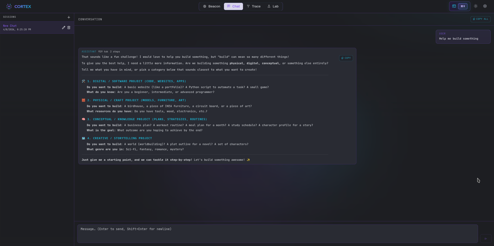

import { Aside } from "@astrojs/starlight/components";

The Chat view provides a conversational interface for multi-turn dialogue with any agent. Chats are listed in the left rail, newest first under **Today** and **Earlier**, with a search box, each chat's model and when it was last used, and a dot on the chat whose reply is running. Each row's **More actions** menu edits the chat's settings, renames it or deletes it. Opening a chat lands on its latest turn. Each chat preserves the full conversation history.

Answers read as prose (15px, a comfortable line length) with code, ids, tool names and token counts in monospace. Your messages sit on the right; the agent's turns sit on the canvas with a thin rail on the left that moves while the turn runs and turns red when it did not finish. An empty chat shows starter prompts.

Chat sessions are powered by `@reactive-agents/svelte` under the hood — the same `createCortexAgentRun` primitive that you can use in your own Svelte frontend.

## What do you want to do?

| I want to... | Go to |
|---|---|
| Read what a chat turn shows: transcript, cost, goals, to-do, failed turns, rich answers | [Chat sessions and turns](/features/cortex/chat-and-composer/sessions-and-turns/) |
| Set the model, tools, workspace and limits, tag files, attach pictures, audio or files | [Composer, Config and attachments](/features/cortex/chat-and-composer/composer-and-config/) |
| Plan first, edit the plan, then Execute | [Plan and Execute mode](/features/cortex/chat-and-composer/plan-and-execute/) |
| Stop, pause and continue a run, compact a long chat, let the agent change its own setup | [Stop, continue, compact and agent control](/features/cortex/chat-and-composer/stop-compact-and-control/) |

## Slash commands at a glance

In a chat, these slash commands drive longer work:

- `/goal`, `/plan`, `/execute` (`/go`), `/loop`, `/schedule`: see [Goals, plans and loops](/features/cortex/goals-plans-loops/). Goal segments, schedule fires and loop ticks stream live into the open chat (tokens, tool chips, to-do updates) like a turn you typed, and reloading the page mid-segment reattaches to it.
- `/agent on` — opt the chat into agent session control ("let the agent manage this chat"). Off by default.
- `/tools` — the tool disclosure picker (`all`, `index`, `discover`, or tier).
- `/mcp` — turn an MCP server on for this chat, or `/mcp add <command or URL>`.
- `/btw <question>` — a read-only side question about the run in progress; never changes the run.

A tool call shows the arguments it was called with as soon as it starts, so a long-running call (a slow shell command, a large fetch) says what it is doing before it finishes; credential-shaped values (API keys, bearer tokens, `?key=` query values) are redacted on screen. A turn that pauses for approval shows an approval card in the thread, and one that asks you a question shows a reply box (Yes/No, choices, form fields, or free text). A live context meter reads the `ContextPressure` event, and a `TokenUsage` event drives the live input/output counters and the per-call strip; estimates are marked `~`. Usage details consolidate into the **Inspector's Context tab** (session, provider/model, context limit, usage, total/input/output/cache tokens, message counts, cost, timestamps, raw messages) alongside Steps and Run trace.

See also [Approvals and questions](/features/cortex/approvals-and-questions/), [Voice](/features/cortex/voice/) and [Memory and skills](/features/cortex/memory-and-skills/).
