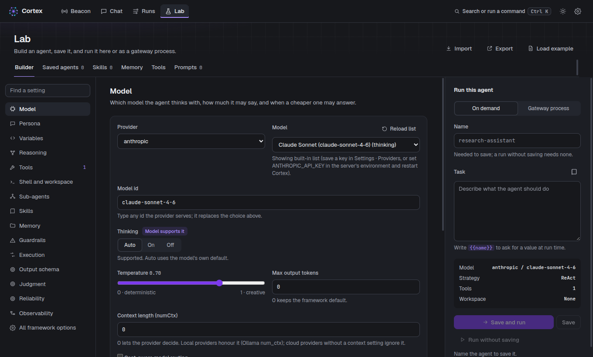

import { Tabs, TabItem, Aside, Card, CardGrid } from "@astrojs/starlight/components";

The Lab (`/lab`) is the **workshop** for configuring and launching agents directly from the Cortex UI without writing code. Its header has **Import** (load an agent config JSON into the Builder), **Export** (the Builder's agent as TypeScript or JSON) and **Load example**.

The TypeScript export is the framework's own `agentConfigToSource` over the same config Cortex builds the agent from, so it matches what Cortex runs: meta tools, skills, agent tools, the host shell and its options, budgets, durable runs and the rest are all in the code. A few things Cortex adds have no config form (a scripted test scenario, host tools such as the chat's session control and Cortex's trace folder); the export lists each one that is set under **Not in this code**, with the builder call to add yourself. Secrets never appear in the code: an API key saved in Settings is left out (the note names the environment variable to set), and MCP server `env` and `headers` values print as `process.env` references. **Copy** and **Download** give you the file. Saved agents export the same way.

| Tab (URL hash)               | Purpose                                                                                                                            |
| ---------------------------- | ---------------------------------------------------------------------------------------------------------------------------------- |
| **Builder** (`/lab`)         | Three columns: a section nav with **Find a setting** (Model, Persona, Variables, Reasoning, Tools, Shell and workspace, Sub-agents, Skills, Memory, Guardrails, Execution, Channels (Telegram, Signal and webhook channels, access control, schedules and queue for a Gateway process agent; see [Gateway and channels](/features/cortex/gateway-and-channels/)), Output schema, Reliability, Observability, All framework options; each setting has one home: approvals in **Tools**, dynamic sub-agents and nested spawning depth in **Sub-agents**, durable runs, token and cost caps, questions to you and webhooks in **Execution**, the typed result in **Output schema**, documents in **Memory**, model routing in **Model**), the chosen section's settings, and **Run this agent**: On demand or Gateway process, a name, the task, a summary of what will run (model, strategy, tools, workspace), then **Save and run**, **Save** or **Run without saving** (a gateway agent: **Create gateway agent**). The **Model** section includes a **Context length (`numCtx`)** field to pin the exact provider context window (Ollama `num_ctx`); it also drives the context-usage gauge. Runs are immediately tracked in Beacon. |
| **Gateway** (`#status`)      | Read-only overview of every saved Gateway process agent: live per-channel connection state, messages in, replies sent and send failures, schedules with next fire and recent runs, queue activity and recent activity. See [Gateway and channels](/features/cortex/gateway-and-channels/). |
| **Saved agents** (`#agents`) | Saved on-demand and gateway agents: status, schedule, runs and stats. **Run** starts one now; **Pause** / **Activate** a gateway agent; **Use in Builder**, edit, export, delete. The old `#gateway` link still opens this tab. |
| **Skills** (`#skills`)       | Two views. **Agent skills**: the skills an agent learned or loaded, kept with its memory. Pick an agent to see each skill's confidence (Tentative, Trusted, Expert), how often it was used, its success rate and when it was last used; its versions (current, on trial) with a line-by-line comparison to the version before; and a history of the skill events its runs reported (used, refined, rolled back, promoted), each linked to the run, plus the refinements and rollbacks you started in Cortex (marked "in Cortex"). **Refine now** runs one refinement pass on the agent's last model and reports how many skills were refined, unchanged, skipped (too little new evidence) or failed; **Lock** keeps a skill as it is (refinement, promotion and automatic rollback skip it) and **Unlock** lets runs evolve it again, with its versions kept either way; **Roll back** restores the previous version (`agent.rollbackSkill`); **Export to SKILL.md** writes the skill into the Builder's workspace under `.agents/skills/<name>/`. **Skill files**: the `SKILL.md` skills an agent built from the Builder can load: the framework's own search at the Builder's workspace (the server's launch folder when none is set), with each folder it looks in and whether it exists. Below them, the **Cortex library** (skills saved in Cortex's database) is deprecated: agents never see it, and **Move into agent skills** loads a row into the agent picked under Agent skills (you choose whether it evolves from runs, waits for review, or stays locked) and removes it from the library. When the agent already has a skill with that name, **Update existing** loads the row as that skill's next version and keeps its history, so you can roll it back. Pin skills by name, add extra folders and turn on home-folder skills in the Builder's **Skills** section. |
| **Memory** (`#memory`)       | An agent's stored memory, read and edited through the framework's `agent.memory()`: pick an agent (any with a memory database under `~/.reactive-agents/memory`), search facts (full text; words of 4 or more characters), browse **Facts** (semantic), **Workflows** (procedural) and **Log** (episodic). Each entry shows where it came from (the run that wrote it, with a link to that run) and its importance, tags and dates. Edit or delete facts and workflows (delete asks first). `?agent=<id>&run=<runId>` opens it narrowed to what one run wrote. |
| **Tools** (`#tools`)         | Workshop for testing individual tools — invoke any registered tool with custom parameters and inspect the result. **Create tool** adds an MCP server (manual setup or JSON import) or a custom Lab tool. |
| **Prompts** (`#prompts`)     | Reusable system prompts, personas, tasks and snippets for the Builder, chat and Beacon.                                             |

---

## Verification, shell, workspace and schema

Cortex’s Lab **Builder** tab tracks the framework, but two options deserve a clear split:

| Control | What it does |
| ------- | ------------ |
| **Verification step → Reflect** | One extra LLM pass that reviews the draft answer (`withVerificationStep({ mode: "reflect" })`). Fast, no separate verification package. |
| **Runtime verification layer** | Enables `@reactive-agents/verification` (`withVerification`) — semantic entropy and related checks. Heavier than reflect; use when you want structured confidence signals. |

**Allowed tools** are chosen in the Lab Builder **Tools** section: quick toggles for common builtins, MCP tools from your saved servers, plus an **Additional allowed tools** field for exact IDs (Lab custom tools, less common builtins). Optional `additionalToolNames` is merged with the toggle list at run time.

Attaching an MCP server makes all of its tools available; click a tool chip to leave one out. The MCP server form also has **Read-only** (off, all tools, or named tools) and **Trust server annotations**. Read-only marks tools as non-mutating so they stay available to read-only senders and to read-only satisfiability checks; trusting annotations honors the server's own read-only hints. Both are your declaration as the operator: a server cannot make itself read-only unless you trust its annotations.

**Host shell (`shell-execute`)** is **off by default**. When you enable it in **Tools**, Cortex registers the framework terminal tool with the default allowlist/blocklist. The shell options below all map to one `ShellExecuteConfig`:

| Option | What it does |
| ------ | ------------ |
| **Allowed commands** | The exact commands the agent may run, as removable chips, starting from the framework defaults. Add a command by name, or use a quick-add button (JavaScript, Python, Web, Archives, Environment) to add an opt-in group's commands. Opt-in commands are marked with a risk note. Commands added to the defaults are saved as `additionalCommands`; removing a default saves the whole list as `allowedCommands`. Configs saved with the old command groups (`commandAccess`) load into the same list. |
| **Runs on** | This machine, or a Docker sandbox with no host files (`sandbox`). |
| **Shell directory** | Directory commands start in, relative to the workspace (`cwd`). |
| **Timeout** / **Output cap** | Per-command time limit and output size; 0 keeps the framework default (30 s, 4,000 chars). |
| **Allow a shell directory outside the workspace** | Lifts the workspace confinement for `cwd` (`allowUnsafeCwd`). |

**Workspace** (top of **Tools**) sets `.withTools({ workspace })`: file tools read and write inside that directory and the shell runs in it. Type a path or press **Browse** to pick one from suggestions or a folder browser (directory names only; hidden folders behind a toggle). Leave it empty and file tools use the server's directory while the shell gets a fresh `/tmp` sandbox. A chat with tools turned off gets none of these: no shell, no workspace, no shell options, whatever its saved config holds.

**Output schema** (its own Lab section) is the typed object the agent returns (`.withOutputSchema`). Add fields with a name, type, description and required flag, or edit the JSON Schema directly (a schema with nested objects or other keywords opens as JSON only). The same field editor lists **Variables**. Once a schema is set, **If the answer does not fit the schema** picks what happens: keep the text answer and report the parse error (`degrade`, the framework default), or fail the run (`throw`). The schema is plain JSON Schema in the agent's config, so it is in the exported code, and the framework refuses a schema it cannot validate when the agent is built.

A run or chat turn with a schema shows its **Structured output** as a table of fields (Raw JSON is one click away), and a **How output was obtained** panel from the framework's report: whether the provider's schema-constrained call answered or prompt mode did, any repairs applied to the model's JSON, and the fields that failed as JSON Pointers. The panel opens by itself when no valid value was produced.

**Ask me questions** (in **Execution**) lets the agent stop and ask you something (`request_user_input`). Without durable execution the question is live: a chat shows it inline in the streaming turn (yes or no, options, form fields or free text) and the same turn carries on with your answer; a desk run's question appears under **Waiting on you** and in the run header. With durable execution the run pauses and survives a restart. Default: chats ask, runs do not; set Yes or No to override. A chat with tools off has no tool layer, so it cannot ask.

Desk runs, chat sessions and saved gateway agents build their agents from the same config. A setting that works in one of them works in all three.

**Guardrails** has a master switch, one switch per framework detector (prompt injection, personal data, toxicity) and a **Blocked phrases** list (`customBlocklist`). The detectors are on/off; there is no sensitivity threshold.

**Advanced — framework config** (in **Reasoning**) fields that are lists or maps (toolset names, focused tools, per-tool call caps, tool risk levels, required tools) use list editors: type a value and press Enter. The toolset-name suggestions for `tools.builtins` (`read`, `research`, `file`, ...) come from the framework, and `tools.disclosure` sets how permitted tools are shown.

**Web search providers** (in **Tools**, in the builder and the chat config panel) pick which search backends the `web-search` tool tries and in what order: click Tavily, Brave Search, Serper, Keenable or DuckDuckGo in the order you want; the number on a chip is its place, and a provider you leave out is never tried. With none picked the framework's default chain applies (every provider that has a key, then DuckDuckGo). It is saved as `tools.webSearch.providers`. The keys themselves come from Settings · Web search or the server's environment.

<Aside type="caution">
**Use host shell only at your own risk.** Allowlists limit which executables may run; blocklists catch many dangerous patterns, but this is still real command execution on your host. Prefer `code-execute` or a Docker sandbox from your application when exposing agents to untrusted prompts. See [Security hardening](/guides/security-hardening/) and the shell execution docs / consumer skill for configuration details.
</Aside>

Ask-me-questions and approvals are covered in [Approvals and questions](/features/cortex/approvals-and-questions/). Judgment is in [Judgments and evals](/features/cortex/judgments-and-evals/).
