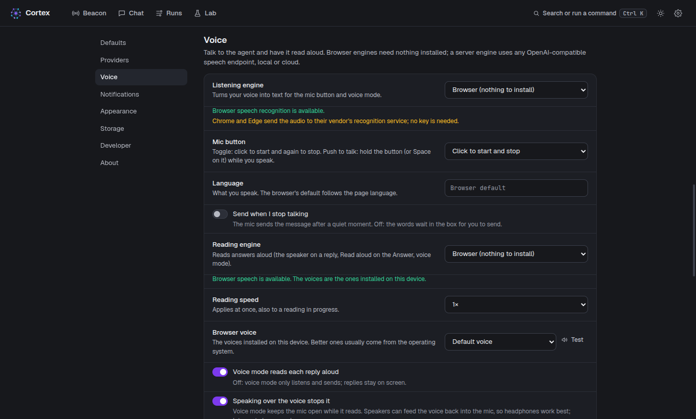

import { Aside } from "@astrojs/starlight/components";



Settings has a section nav on the left and one row per setting. **Save settings** writes Defaults, Providers, Notifications, Storage and Developer; Appearance applies at once.

-   **Defaults** — the provider and model that Beacon, new chats and the Lab Builder start with. A provider without its API key reads "(key missing)", and the help text names the variable to set.
-   **Providers** — one row per cloud provider (Anthropic, OpenAI, Gemini, Groq, xAI, LiteLLM, Ollama Cloud) saying which key agents use, plus a **TypeSafe (Jev judgment)** row for the judgment backend, then the Ollama endpoint and whether the Cortex server is connected. For **Ollama Cloud**, press the **Ollama Cloud** preset beside the endpoint (it fills `https://ollama.com`), press **Apply**, and add your Ollama API key; the endpoint then applies to runs, chats, helper agents, the model list and capability checks, and the model picker lists the cloud models. The Ollama key is sent only to a non-local endpoint, never to `localhost`; a rejected key reads "Ollama Cloud key missing or invalid" with a link here. Judgments (below) cannot use Ollama Cloud: Ollama's scoring models run on local weights only. **Add key** / **Replace** saves a key on the Cortex server, **Test** lists the provider's models with it (a typed key is tested before you save it), **Remove** deletes it. Saved keys are encrypted (AES-256-GCM) in `.cortex/` beside the database, in files only your user can read, and the browser only ever sees `••••` plus the last four characters. A key in the server's environment (or `.env`) wins; when both exist, **Use the saved key instead** switches to the saved one. Agents get the saved key through `.withProvider(provider, { apiKey })`, for every provider listed.
-   **Voice** — how the mic listens, how replies are read, and voice mode (see [Voice](/features/cortex/voice/) below). These apply at once and are not part of **Save settings**.
-   **Notifications** — allow desktop notifications and pick which runs notify you.
-   **Appearance** — **Theme** follows the system setting or pins dark or light (the top-bar switch pins the opposite of what is showing). **Motion** follows the system's reduced-motion setting or reduces motion in Cortex regardless: it stops the ambient drift, the logo twinkle and the live animations, and running work still shows in status text.
-   **Storage** — how long to keep runs, and **Prune now** to delete older ones. Runs live in `.cortex/cortex.db` under the server's working directory.
-   **Developer** — debug mode, hover tooltips, and how to connect an app (`.withCortex()` or `CORTEX_URL`).
-   **About** — the Cortex and framework versions. Run from a source checkout, Cortex reads the repo's `VERSION` file and shows the git commit; an installed package shows its released version.

Both themes come from one set of design tokens, so every page reads the same in either. Fonts and icons are bundled with Cortex; nothing loads from a font CDN.

## Request guard and listen address

Cortex has no login. By default the server binds `127.0.0.1`, so only your own computer can reach it. On top of that bind, every `/api/*` and `/ws/*` request is checked against a Host and Origin allowlist, which stops a DNS-rebinding page from reaching a loopback Cortex through your browser. A request that fails the check gets `403 Forbidden: Host or Origin not allowed. Set CORTEX_ALLOWED_HOSTS to add a name.` No CORS headers are ever added.

- **Allowed `Host`:** `localhost`, `127.0.0.1`, `[::1]` (any port), any IP address literal, the host of `CORTEX_URL`, and the comma-separated names in `CORTEX_ALLOWED_HOSTS`.
- **Allowed `Origin`:** the same names, except IP addresses other than loopback: a page served from a LAN address cannot call a loopback Cortex.

Serving Cortex under a DNS name (a reverse proxy, a tailnet name, a team host) therefore needs that name allowed:

```bash
CORTEX_HOST=0.0.0.0 \
CORTEX_ALLOWED_HOSTS=desk.internal,cortex.team.example \
rax cortex
```

<Aside type="caution">
Anyone who can reach a non-loopback address can browse folder names, read skill files and start agent runs. Expose Cortex only on a network you trust, or behind your own authentication.
</Aside>

### Environment Variables

| Variable                 | Default                 | Purpose                                                      |
| ------------------------ | ----------------------- | ------------------------------------------------------------ |
| `CORTEX_PORT`            | `4321`                  | Cortex server listen port                                    |
| `CORTEX_HOST`            | `127.0.0.1`             | Interface the server binds (loopback only by default)        |
| `CORTEX_URL`             | `http://localhost:4321` | Base URL used by `.withCortex()` if not passed explicitly    |
| `CORTEX_NO_OPEN`         | unset                   | Set to `1` to prevent opening a browser on server start      |
| `CORTEX_LOG`             | `info`                  | Server log verbosity: `error` \| `warn` \| `info` \| `debug` |
| `CORTEX_SKILL_SCAN_ROOT` | —                       | Extra folder suggested in the workspace picker (and scanned by the older `GET /api/skills/files`) |
| `CORTEX_ALLOWED_HOSTS`   | unset                   | Extra host names the request guard accepts (comma-separated) |
| `CORTEX_CHAT_MAX_SESSIONS` | `8`                   | Cached chat agents kept in an LRU                            |

## Model pages

The model link in a chat turn or under Defaults opens the **model page** (`/models/<provider>/<model>`): context window, max output, tool-call support and thinking, the remaining capability values, a note when the values are fallback defaults rather than measured ones (with what recorded runs on that model used), recent runs by name, and **Start a chat with this model**. Two more sections show what the model costs and how the harness adapts to it:

- **Spend** — over the model's last 50 runs in Cortex: total spend (priced by the framework when each call finished; marked `≥` when a call reported no cost), spend per successful run (all spend divided by the runs that finished with a full answer, so failed runs count against the successes), and tokens in, out and served from the prompt cache. Calls on another model inside the same runs (a fallback) are not counted.
- **Calibration** — the framework's calibration for the model, as a run with calibration on receives it: tool result size, attention to instructions, act or answer, tool classifier, parallel tool calls, shortened results and tool-call format, each in plain words with what it does and whether it is **Shipped** (the measured calibration) or **Learned** from your runs (with the shipped value it replaced). Below: how many runs the framework has observed on this model and the counts behind the learned values (learning starts at 5 runs), and the uncertainty thresholds the reactive-intelligence sensor learned from scored steps. **Strategy learning** lists, per kind of task, how each reasoning strategy did on this model as the framework's strategy chooser learned it (success estimate and runs scored, best marked; a run counts as a success when its average uncertainty stayed below 0.5), read from the calibration database. A model with no shipped calibration runs on the harness defaults, and the page says so. Cortex only reads calibration; it never changes it.
