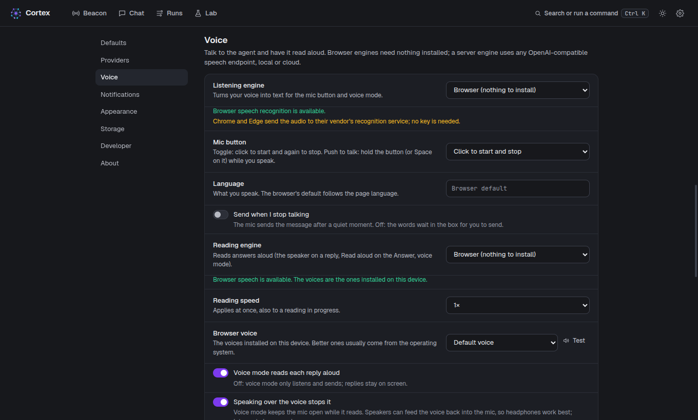

import { Aside } from "@astrojs/starlight/components";



Voice is for the chat and the run view's Answer. It has three parts, each usable on its own.

- **Dictation (the mic button in the composer).** Click it to start and click again to stop, or switch it to push to talk in Settings · Voice and hold it while you speak. The words appear at the cursor as you say them, in the middle of whatever you already typed, and never replace it. Esc stops. A language setting picks what you speak. With **Send when I stop talking** on, the message is sent after a quiet moment (800 ms to 3 s, your choice); off, the words wait in the box for you to send.
- **Read aloud.** Every agent reply has a speaker button; the run view's Answer has **Read aloud**; the chat header has **Read the conversation aloud**. A bar above the composer shows play/pause, stop, previous and next sentence, speed (0.75× to 2×), the voice, and the sentence being read, which is also highlighted in the answer in browsers that support the CSS Custom Highlight API. Long text is read a sentence at a time. Code blocks and tables are announced ("Code block in typescript, 12 lines.") and not read out; headings and lists get a pause; links read their label.
- **Voice mode (the waveform button).** A hands-free loop: it listens, sends your message when you stop talking, waits for the reply, reads it aloud, and listens again. The bar above the composer always says where it is (Listening, Thinking, Speaking, Waiting for your approval or answer, Paused), shows the words heard so far, and has an always-visible **Stop voice mode** (Esc does the same). **Interrupt** cuts the voice or the running reply and listens again. Speaking over the voice stops it (barge-in). The voice's own sound can come back through speakers and the mic, so Cortex ignores heard words that are part of what it is saying; **headphones work best**, and you can switch barge-in off in Settings. Approvals and questions from the agent appear as cards in the thread and wait for a click: voice mode never answers them for you. After a quiet minute of nothing heard, it ends itself.

**Engines.** Each direction has two:

| | Browser (default) | Server (OpenAI-compatible) |
| --- | --- | --- |
| Listening | The browser's speech recognition. Nothing to install. Chrome and Edge send the audio to their vendor's recognition service; Firefox and Safari differ or lack it. | Cortex records in the browser and sends the audio to `POST <url>/audio/transcriptions` on a server you choose. |
| Reading | `speechSynthesis`: the voices installed on the device. | Cortex sends each sentence to `POST <url>/audio/speech` and plays the audio. |

The server engines work with anything that copies the OpenAI audio API, so one setting covers local and cloud. Set the endpoint under Settings · Voice (pick a preset or enter a URL that ends in `/v1`), then press **Save endpoint** and **Test**. The Test button for reading also plays a short phrase so you hear the voice. Recommended local setups:

| For | Server | Endpoint | Model | Notes |
| --- | --- | --- | --- | --- |
| Listening | Speaches (formerly faster-whisper-server) | `http://localhost:8000/v1` | `Systran/faster-whisper-small` (or larger) | Runs on CPU or GPU; audio stays on your machine. Models are not preloaded: download one first (below). |
| Reading | Speaches (Kokoro) | `http://localhost:8000/v1` | `speaches-ai/Kokoro-82M-v1.0-ONNX` | Voice `af_heart`; `response_format` `wav` or `mp3` both work. Same container as listening. |
| Listening | whisper.cpp `whisper-server` | `http://localhost:8080/v1` | the model it loaded | Start it with `--inference-path /v1/audio/transcriptions`. |
| Reading | Kokoro-FastAPI | `http://localhost:8880/v1` | `kokoro` | Natural voices (`af_bella`, `am_adam`, …); **List voices** shows what it offers. |
| Reading | openedai-speech (Piper) | `http://localhost:8000/v1` | `tts-1` | Maps the OpenAI voice names to Piper voices. |
| Either | OpenAI | `https://api.openai.com/v1` | `whisper-1` / `tts-1` | Needs an API key; your audio or text leaves the machine. |

## Speaches setup

 Run the container (`ghcr.io/speaches-ai/speaches:latest-cuda`, or the CPU image) on port 8000, then download the models you use; Speaches does not preload any, and an undownloaded model answers 404 "Model … is not installed locally":

```bash
curl -X POST http://127.0.0.1:8000/v1/models/Systran/faster-whisper-small
curl -X POST http://127.0.0.1:8000/v1/models/speaches-ai/Kokoro-82M-v1.0-ONNX
curl http://127.0.0.1:8000/v1/models   # lists what is installed
```

If **Test** hits that 404, Settings · Voice shows the download hint and a copyable `curl` command for the model you set.

An API key, when the endpoint needs one, is saved through the same encrypted store as the provider keys (`.cortex/`, files only your user can read) and used only by the Cortex server; the browser never receives it, and the settings page shows `••••` plus the last four characters. A key in the server's environment works too (`CORTEX_VOICE_STT_API_KEY`, `CORTEX_VOICE_TTS_API_KEY`). The status lines under each engine say what is available and, for a cloud endpoint, that audio or text is sent there. Cortex relays audio and never stores it: no recordings, no generated speech on disk. A recording is limited to 25 MB and one speech request to 4096 characters (longer text is split into sentences). Closing the page or pressing Stop cancels the call to the audio server.

Language, speed, the browser voice and the mic mode are kept by the browser; the engines, endpoints, models and server voice are kept on the Cortex server. Microphone access needs a secure page: open Cortex on `localhost` or over https.

Step-by-step local setups, including the Speaches container, are in [Local setup recipes](/features/cortex/local-setup-recipes/).

## Troubleshooting

**Reading starts and stops at once, or you see "Something outside Cortex paused the audio".** Cortex retries once, then stops the reading and tells you instead of looking like it is playing. Something outside the page is pausing its audio: usually a browser extension that manages media (a media-key or "pause other tabs" tool) or a desktop media controller. Open Cortex in an Incognito or private window to check; if it works there, disable the extension for Cortex's address. Or set **Reading engine** to **Browser** speech, which does not use an audio element. **Audio diagnostic**, next to **Test** under Reading engine, plays a short tone through the same path and reports whether it played, was paused by something outside Cortex, or was blocked by the browser (which only plays sound after you interact with the page).
